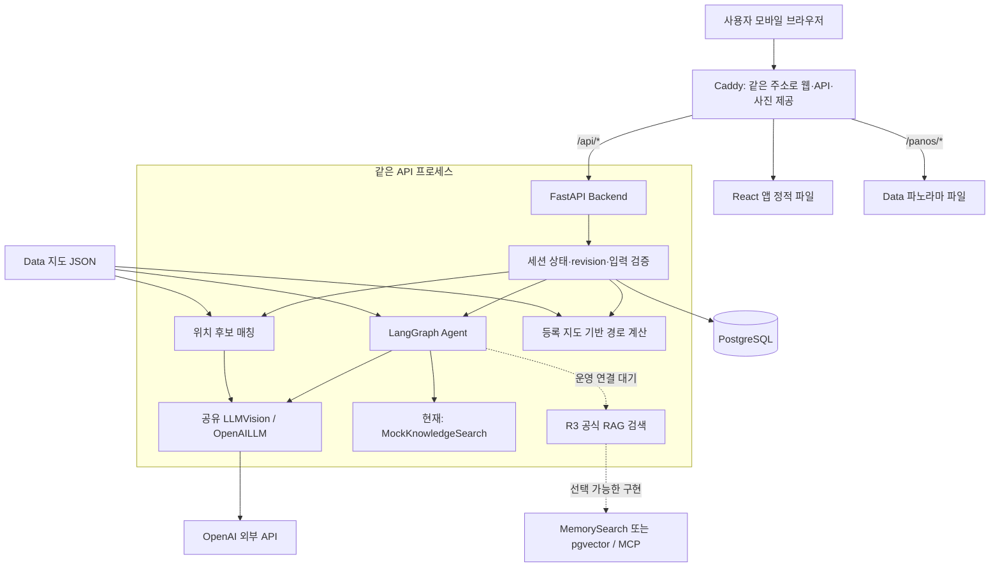

# 현재 전체 아키텍처 — 2026-10-23

관찰 기준: 16:16 KST, 실제 코드·원격 main·CI·읽기 전용 배포 GET. [구조화 증거](../reports/architecture-review-20261023.json), [계약 감사](../reports/architecture-contract-audit-20261023.json), [경계·경로 재현](../reports/architecture-boundaries-20261023.json), [배포 GET](../reports/architecture-server-readonly-20261023.json).

사용자가 제공한 토론은 참고 맥락이다. 더미 위치·텍스트 전용·가상 역·도착지 입구 사진을 확정 요구로 적용하지 않았다. 아래는 현재 구현이며 설계 제안과 구분한다.

## 현재 버전과 배포 구분

| 저장소 | main | 책임·최신 상태 |
|---|---|---|
| oneload-app | 42455dc | React/TypeScript/Vite 모바일 웹. HTTP 기본, 명시적 mock. CI 성공 |
| oneload-backend | 15ddd9f | FastAPI, 세션·위치 후보·경로·DB·API 계약. 해당 커밋의 과거 CI 성공은 새 Agent 조합 통과를 의미하지 않음 |
| oneload_agent | eca420e | Python/LangGraph, 출구·카드 반납·티켓 구매·탑승 분기, 프롬프트 v4·최종 관련성 검사 추가. 최신 CI 실패·배포 skipped |
| oneload-rag | 8c8e902 | 공식 안내 문서·MemorySearch·pgvector 구현·MCP 서버 제공. 운영 entrypoint에 미연결 |
| oneload-data | 3b5ef0e | 지도2026-10-23.1, 반납기·1번 출구 추가. 스키마 CI 성공, 경로 연결 문제 별도 |
| oneload-infra | 6cf4a65 | Docker Compose·Caddy·공용 macOS 배포 workflow |
| oneload-qa | 이 문서를 포함한 커밋 | 검토 전084fafa, 모의 검증·평가셋·계약 검사·증거·인수인계 |

전체 SHA는 [manifest](../repos.lock.json)에 있다. 16:16에 7개 원본 checkout은 clean이고 원격 main과 일치했다. QA만 이 검토 후 별도 변경한다.

16:14 배포 GET은 첫 화면·health·OpenAPI·지도 모두200, DB ok, LLMAgent/LLMVision 표시다. 그러나 서버 지도는 **2026-10-22.1 / 10노드**, 최신 저장소 지도는 **2026-10-23.1 / 12노드**다. 공개 OpenAPI도 기존 intent 6개다. 따라서 새 기능의 배포 완료로 표시하지 않는다. GET은 현재 Agent SHA나 모델 정확도를 증명하지 않는다. 마지막 성공 배포에서 확인한 Agent5038b5c와 이번 실패한 eca420e를 구분한다.

## 실행 구조

저장소는 역할별로 나누지만, 현재 실행은 **Backend 프로세스에 Agent를 Python 패키지로 넣는 구조**다. Agent별 HTTP 서버나 RAG MCP 서버가 현재 운영 호출 경로에 연결돼 있는 구조는 아니다.

실선은 현재 코드의 호출·데이터 경로, 점선은 운영 연결이 남은 R3 확장이다. 그림의 Agent/위치/경로 상자는 별도 컨테이너가 아니라 API 내부 책임이다.

핵심 실행 컨테이너는 db·api·caddy 3개다. DB는 pgvector 확장이 포함된 PostgreSQL17 이미지지만, 이것만으로 RAG 벡터 검색이 사용 중이라는 뜻은 아니다. API는 지도 JSON을 읽기 전용 마운트하고, Caddy는 앱 빌드와 파노라마를 제공하며 API 요청을 api:8000으로 넘긴다. 호스트 loopback4173을 Tailscale Funnel이 외부 HTTPS로 연결한다.

## 각 계층이 결정하는 것

**앱:** 채팅, 사진 촬영·첨부, 위치 후보 확인, 목적지 선택, 단계 안내·도식형 노선·360도 거리뷰, 언어·홈 메뉴를 제공한다. `ApiAdapter` 뒤에서 기본 HTTP와 명시적 mock을 바꾸며 화면 흐름을 공유한다. mock의 고정 사진 결과를 실제 Vision 정확도로 간주하지 않는다. 상태·revision은 Backend 응답을 따른다. 재시도에는 같은 idempotency key를 쓰고 충돌 시 서버 상태를 다시 읽는다. 안내 이벤트 outbox는 시작→도착 순서와 중복 방지를 담당한다.

**Backend:** 세션 토큰 인증, 상태 전이, 데이터 검증, Agent 입력 조립·출력 guard, 사진 후보·위치 확정, 지도 조회·경로 계산·이벤트·피드백을 담당한다. DB에 세션, 메시지 이력, 슬롯, 위치 후보, 경로, 이벤트, 피드백, 멱등성 정보를 저장한다. 세션2시간·후보5분·멱등키24시간은 현재 설정값이며 성능 측정 결과가 아니다. 현재 사진 업로드 원본을 저장하는 흐름은 없다.

**Agent:** 사용자 말과 최근 대화·슬롯을 받아 필요한 질문 또는 다음 행동을 선택한다. 현재 그래프는 `read_photo → understand → update_slots → 조건 분기 → END`이며 응답을 만든 뒤 `verify`를 호출한다. 분기는 안전·범위 안내, 길 잃음, 열차 종류/카드 확인, 자료 답변, 등록 목적지 선택, 새 출구·반납·구매·탑승 안내다. LangGraph 체크포인터에 세션을 보관하지 않고 Backend가 저장한 대화·슬롯으로 다음 요청의 context를 구성한다.

**LLM/Vision:** `understand`는 의도·슬롯을 구조화하고, `compose`는 검색 자료를 문장으로 만들며, `read_scene`은 사진의 글자·시설·품질을 추출한다. 새 `verify`는 질문과 최종 응답의 관련성만 검사한다. 사진 모델이 node_id나 이동 경로를 직접 결정하지 않는다. 키가 있으면 운영 entrypoint는 LLMAgent와 동일한 LLMVision을 대화 사진/위치 사진에 공유하고, 키가 없으면 RuleAgent/NoVision이다. 모델 장애 때 규칙 기반 대체 또는 사진503→수동 선택으로 처리한다.

**RAG:** 공식 Markdown 지식에서 관련 문서와 URL·확인일을 반환하는 모듈이다. DB 없는 키워드 MemorySearch, pgvector+임베딩 검색, MCP 제공 방식이 구현돼 있다. 다만 현재 Backend `production_ai()`는 **MockKnowledgeSearch**를 주입한다. QA의 공식 MemorySearch 주입 검증과 실제 운영 기본 경로를 구분해야 한다. MCP 구현이 있다는 사실만으로 Agent가 MCP로 검색하고 있다고 설명하면 안 된다.

**Data:** 층·노드·통로·목적지 POI·표지판 landmark·파노라마·좌표 규약을 JSON으로 관리한다. API 시작 시 읽으며 지도 버전이 다르면 클라이언트가 다시 받아야 한다. POI의 `verified` 플래그는 코드가 허용하는 목적지 여부다. 지도 provenance가 명시한 통로·거리·좌표·방향·표지 문구는 답사 전 placeholder이며 파노라마6개는 다른 역의 예시다. 실제 서울역 동선 검증 완료를 뜻하지 않는다.

**QA/Infra:** QA는 운영 요청 경로 밖에서 계약·회귀·평가·증거를 관리한다. Infra는 빌드·비밀 설정 주입·서비스 갱신을 담당하며 런타임 기능 결정을 하지 않는다.

## 대표 요청 흐름

1. **대화·목적지:** 앱이 세션을 만들고 `/messages`로 문장/선택 POI/선택적 사진을 보낸다. Backend가 저장 이력·슬롯·위치·지도를 AgentContext에 넣고 Agent를 호출한다. Agent가 확인 질문·답변·목적지를 반환하면 guard가 등록 POI와 실제 검색된 출처 ID를 검사한다. Backend가 상태·revision·이력·슬롯을 저장하고 앱이 응답을 표시한다. 새 intent의 API 계약 오류는 아래 제한이다.
2. **사진 위치:** `/localizations` → VisionFeatures(글자·시설·품질) → Backend가 지도 landmark와 매칭해 최대3개 후보 → 앱이 근거와 함께 표시 → 사용자가 `/location-confirmations`로 확정. 불명확하면 재촬영/수동 선택이다. 사진 한 장에서 연속 위치 추적이나 실제 좌표 정합을 수행하는 구조는 아니다.
3. **길안내:** 목적지·확정 위치가 준비되면 `/routes` → Backend가 지도 유향 그래프에서 거리 가중 Dijkstra → 등록 간선 문구·거리·층·파노라마·화살표를 반환한다. 화살표는 `north_yaw_deg + heading_deg`로 계산한다. 앱은 이를 단계·노선·거리뷰로 보여 준다. 없는 통로는 만들지 않고 ROUTE_NOT_FOUND다.
4. **이동 중 질문·복구:** 사용자가 채팅으로 돌아가 질문하거나 길을 잃었다고 알리면 위치를 다시 확인하고 같은 목적지로 재탐색한다. '다음' 버튼으로 화면 단계를 넘기며 시작·도착·취소 이벤트를 서버에 보낸다. GPS/AR로 실제 도착을 자동 감지한 결과가 아니다.

## 서로 다른 세 가지 상태/그래프

| 종류 | 목적 | 유지 위치 |
|---|---|---|
| Backend 세션 상태 | 질문·위치 필요·확인 대기·안내 준비·이동·도착의 API 허용 순서 | PostgreSQL 세션과 상태 전이 테이블 |
| Agent LangGraph | 이번 발화에서 어떤 질문·도구·행동을 선택할지 | 요청 안의 그래프 실행, 다음 턴은 Backend context로 복구 |
| 지도 그래프 | 실제 등록된 노드·통로 사이에서 경로 계산 | Data JSON → API 메모리의 NetworkX 유향 그래프 |

일반 흐름은 `idle → needs_clarification → needs_location → needs_confirmation → ready_to_navigate → navigating → arrived`다. 확인 질문은 필요한 경우만 거치고 수동 위치 확인·이미 확인된 위치에 따라 일부 단계가 생략된다. 이 세 그래프를 하나로 합쳐 설명하면 슬롯 기억·실제 이동·대화 분기 책임이 혼동된다.

## 빌드·배포와 버전 관리

App·Backend·Agent의 main CI 성공 후 Infra의 공용 reusable workflow를 부른다. self-hosted macOS runner가 Backend/Agent/Data/App/Infra의 main을 체크아웃하고 호스트 lock으로 배포를 직렬화한다. Backend에서 호출한 배포만 서버 설정 파일을 갱신한다. 로컬 Backend는 형제 `../oneload_agent`를 editable로 설치하고, CI/이미지/배포에서는 `pin_agent.sh`로 선택한 Agent SHA의 archive URL과 lock을 고정한다.

주의할 구조적 한계: **실행 시 Agent SHA를 고정하는 것과, 그 조합을 사전에 통합 검증하는 것은 다르다.** 공용 배포는 다른 저장소들의 main을 다시 가져오므로 호출한 저장소의 과거 CI 성공만으로 새 Agent/Data까지 검증됐다고 볼 수 없다. 현재 eca420e의 Agent 배포는 자체 CI에서 막혔지만 다른 caller의 새 배포가 가져갈 조합도 별도 확인해야 한다. 개선안은 검증된 저장소 SHA 묶음을 배포 manifest로 고정하고 같은 조합의 계약·API 검사를 통과시킨 뒤 배포하는 것이다. 이번 작업에서 배포 정책을 변경하거나 배포를 실행하지 않았다.

## 현재 문제와 우선순위

1. **P0, Agent↔Backend 계약 회귀:** eca420e는 새 intent3개와 슬롯4개를 추가했지만 Backend는 이전 규격이다. `공항티켓 어디서 구매해?`에서 `purchase_arex_ticket`을 `MessageOut`이 거절해500이 난다. 새 슬롯도 다음 BackendContext에서 사라진다. 로컬·CI 재현, [Agent #7](https://github.com/team-onetruck/oneload_agent/issues/7). 계약·저장·Frontend 타입·다중 턴 API를 함께 맞춰야 한다.
2. **새 목적지 경로 단절:** `line1-gates → 반납기 → exit-1`만 연결됐다. 대합실·KTX·4호선·공항철도 승강장에서는 두 목적지 경로가 없다. [Data #2](https://github.com/team-onetruck/oneload-data/issues/2). 실제 통행 방향·개찰구 제약을 반영해 연결해야 하며 무조건 양방향으로 바꾸는 것을 뜻하지 않는다.
3. **공식 RAG 운영 미연결:** Backend #1 / Agent #4 / QA #3로 추적하는 INT-07 partial이다. RAG를 별도 시험에 주입한 결과를 운영 연결 완료로 바꾸지 않는다.
4. **답변 근거·인용 미완료:** 새 verify에는 검색 문서 본문이 들어가지 않는다. 질문과 응답의 관련성 검사이며 자료가 답을 뒷받침하는지 검증하는 구현은 아니다. `_answer`는 hits가 있으면 answered, `_sources`는 hits 전체, 인용 위반 시 자료 안내 fallback이 남아 있다. [Agent #5](https://github.com/team-onetruck/oneload_agent/issues/5)와 RAG #3을 해결로 닫지 않았다.
5. **현장·실제 AI 인수 대기:** 실시간 AR·가상 역·실제 평면도·도착지 입구 전용 사진 기능은 현재 구현 범위에 포함하지 않는다. 현장 사진 정답0·예시 사진·위치 매처의 정확 일치 한계·실제 모바일 카메라/AI 응답 정확도·추가 verify 호출의 지연/비용 평가가 남아 있다.

전체 방향은 LLM의 역할을 의도·자료 설명·사진 특징으로 제한하고, 위치 확정·등록 경로·세션을 서버와 사용자에게 맡긴 점이 명확하다. 현재 우선할 일은 기능 확장보다 **공유 계약 동기화 → 목적지 경로 연결 → 공식 RAG 연결·근거 판정 → 실제 화면·사진 인수**다.

## 이번 검증 범위

2026-10-23 16:12 KST, FakeLLM·합성 입력·새 일회용 DB 사용, 실제 모델/임베딩 호출0회:

- QA44/44, Agent47/47, 데이터3/3, component v2 20/20시나리오·21/21턴.
- 계약 INT-02 실패, 기존 INT-07 partial 유지, Backend50/51(위 messages500 1건).
- Backend 시험 실패로 후속 모의 API20·RAG API21은 이번 조합에서 실행하지 않았다. 과거 baseline 통과를 최신으로 재라벨하지 않았다.
- component는 API 직렬화 경계를 통과하지 않으므로 위500과 동시에 통과할 수 있다. 실제 AI 품질·현장 인식·전체 서비스 성공률이 아니다.
- v4 평가를 위해 QA의 v3 고정을 제거하고 선택 Agent의 기본 버전과 verify 파일까지 검증·해시한다. 평가 질문·정답·SHA는 변경하지 않았다.
- 최종 공개 baseline은 필요한 API 증거가 없어 이전 조합을 보존했다. 최신 실패는 별도 보고서와 이 문서가 우선이다.

주요 구현 근거: [Backend entrypoint](https://github.com/team-onetruck/oneload-backend/blob/15ddd9feb7bd60f9fdc141b449e1bd1b98c2d506/app/main.py), [경로 계산](https://github.com/team-onetruck/oneload-backend/blob/15ddd9feb7bd60f9fdc141b449e1bd1b98c2d506/app/domain/routing.py), [위치 매칭](https://github.com/team-onetruck/oneload-backend/blob/15ddd9feb7bd60f9fdc141b449e1bd1b98c2d506/app/domain/localization.py), [Agent](https://github.com/team-onetruck/oneload_agent/blob/eca420e9321272333db5c5499a2af752e1cb7b69/hangil_r2/agent.py), [App Adapter](https://github.com/team-onetruck/oneload-app/blob/42455dc8e08cc34a596b58fc70431bd25c8dd5e5/src/api/index.ts), [공유 배포](https://github.com/team-onetruck/oneload-infra/blob/6cf4a65ca6e34f0e673dadf428e2c2e925d20107/.github/workflows/deploy.yml), [Compose](https://github.com/team-onetruck/oneload-infra/blob/6cf4a65ca6e34f0e673dadf428e2c2e925d20107/macserver/compose.yaml).
