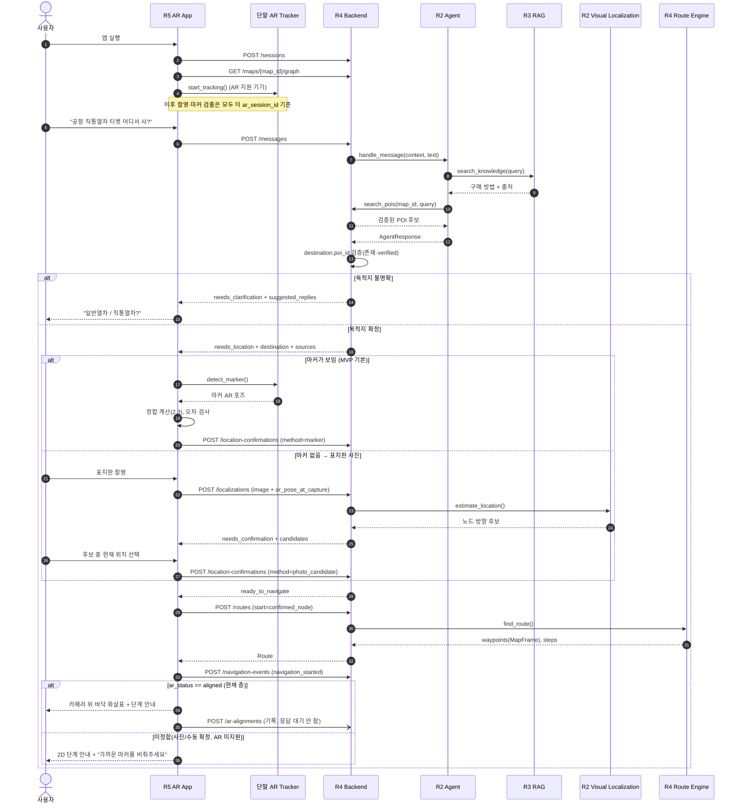
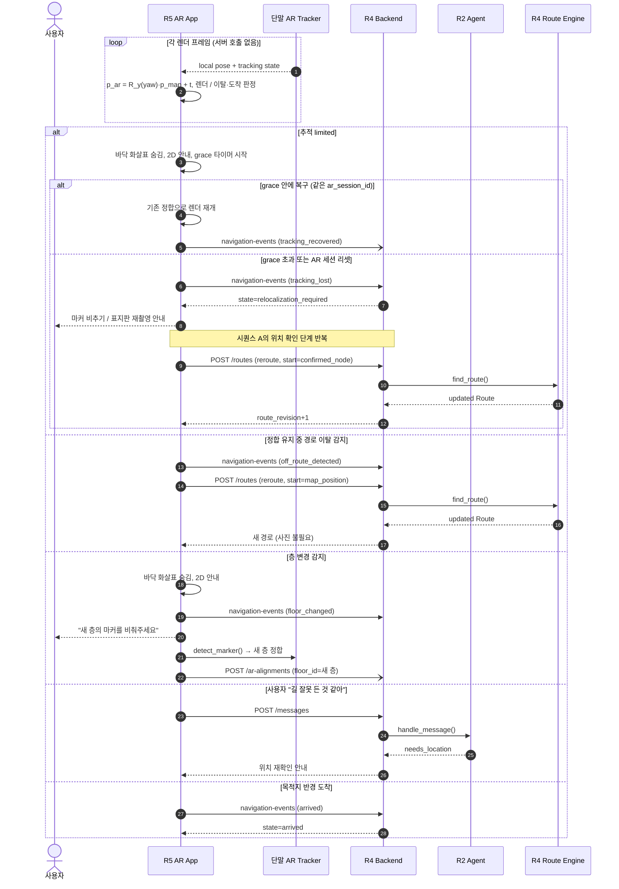

# 한길(Hangil) — 문제 해결형 AR 내비게이션 API·시퀀스·JSON 명세

- 버전: v0.3 (팀 협의 초안)
- 기준일: 2026-10-22
- 핵심 UX: 사용자가 **자연어로 문제를 말하면** Agent가 목적지·행동을 판별한다. 사용자는 **휴대폰 카메라를 켠 채 AR 경로**를 보고 이동한다.
- 초기 지도: 팀이 구축·검증한 소규모 실내 공간 데이터. 네이버 실내지도 데이터/측위 API 사용을 전제로 하지 않는다.
- 기술 제안: **Unity + AR Foundation 네이티브 앱(Android ARCore / iOS ARKit)** 을 AR 클라이언트로 우선 검토. 기존 웹 UI가 필요하면 웹을 정보/관리·데모용으로 유지하고 AR 기능은 앱에서 제공한다. 플랫폼 선정은 기기 실증 후 확정.
- 주의: 3D 지도 모델은 **경로 표현용**이고 자동 실내 측위 기능은 아니다. AR 카메라 추적의 **로컬 좌표계**와 실내 지도 **좌표계의 정합(alignment)** 이 필수다.

## 0. v0.2 대비 변경 사항

| # | 변경 | 이유 |
|---|---|---|
| 1 | 좌표계를 **왼손 좌표계**(Unity 규약)로 정정 | v0.2의 "오른손 + x=동, y=위, z=북"은 성립하지 않는 조합 |
| 2 | AR 추적을 **사진 촬영 전**에 시작, 촬영 시 `ar_pose_at_capture` 전송 | 촬영 시점 pose가 없으면 위치 인식 결과를 AR 좌표에 연결할 수 없음 |
| 3 | 역할 분리: **사진 인식 = 개략 위치(노드 단위)**, **정합 = 측량된 마커** | 노드 단위 위치(수 m 오차)로는 바닥 화살표 정합 불가 |
| 4 | 정합 표현을 4×4 행렬 → **4DoF(`translation_m` + `yaw_deg`)**, 층별 범위 지정 | 중력축은 기기가 알고 있음. 행렬 저장·곱셈 규약 혼동 제거 |
| 5 | 예시 데이터 층·좌표 정합성 수정 | POI 층과 노드 층 불일치, 수직 계단 |
| 6 | `/routes`에 `start.type = "map_position"` 추가, 이탈·도착 판정 기준 정의 | 정합 유지 중에는 사진 없이 재탐색 가능해야 함 |
| 7 | 추적 불량 시 **유예 단계(grace)** 후 재촬영 | ARCore/ARKit은 단기 유실을 스스로 복구하는 경우가 많음 |
| 8 | AR 렌더 여부는 **기기에서 판단**, `/ar-alignments`는 비동기 기록 | 지하 네트워크 불안정 시 AR 정지 방지 |
| 9 | `state`(세션) / `status`(리소스) 분리, `ar_status`(기기) 분리, **상태 전이표** 추가 | 용어 혼재, 호출 가능 조건 불명확 |
| 10 | `expected_revision`, `Idempotency-Key` 도입 | 409 충돌을 실제로 판정할 수단이 없었음 |
| 11 | `find_route`는 Backend만 호출, 목적지 지정은 `/messages`로 일원화 | 호출 주체·경로 중복 |
| 12 | 오류 코드 보완, 토큰 수명, 이미지 정책, `score`→`rank_score`, 피드백 경로 이동 | 누락 항목 보완 |
| 13 | `/messages` 응답에 `sources` 추가 | Agent 답변의 RAG 근거를 화면에 표시 |

## 1. 역할·데이터 소유권

| 구성요소 | 담당 | 입력 | 반환/책임 |
|---|---|---|---|
| AR 클라이언트 | R5 정민규 | 사용자 음성/문자, 카메라, 기기 AR pose, 지도·경로·랜드마크 | AR 추적, **마커 검출·정합 계산·렌더 여부 판단**, 이탈·도착 판정, 2D 대체 안내 |
| Backend/API | R4 박희태 | REST 호출, 식별자, 이미지, pose 요약 | 세션 상태·revision 관리, 토큰·입력 검증, 저장, 내부 모듈 호출, POI 검증 |
| AI Agent | R2 정유은 | 대화 문맥, 지도 메타데이터, tool 결과 | 의도·슬롯 추출, 추가 질문, Tool 호출 결정, 안내 응답 |
| Visual Localization | R2 정유은 | 사진, 촬영 pose, 지도 랜드마크 | **노드 단위 개략 위치·방향 후보**와 근거 |
| RAG/Data | R3 신준엽 | 교통 이용법 검색 | 근거 있는 답변 조각, 출처, 갱신일, 장소 별칭 사전 |
| 경로 엔진 | R4 박희태(지원: 팀 공동 공간데이터) | 출발점(노드/지도좌표), 목적 POI, 제약 | 노드 경로, 3D waypoint, 층 전환, 이동 규칙 |
| 공간 데이터 | R4 주관, 팀 공동 측량 | 현장 답사·측량 | 노드·엣지·POI, **마커 6DoF 포즈(측량값)**, `map_version` |
| QA/Eval | R6 이현무 | 테스트·진단 이벤트 | 인식 성공, 정합 오차/드리프트, 경로 정확도, 임계값 확정 |
| PM | R1 천성훈 | 전 모듈 진척 | MVP 구역·단말·범위, 스키마 버전 고정, 통합 승인 |

## 2. 좌표계·정합 계약 (구현 착수 전 고정)

### 2.1 MapFrame
- 식별: `map_id` + `map_version`. 단위 `meter`.
- **왼손 좌표계(Unity와 동일)**: `x` = 동쪽(도면 가로 +), `y` = 위(중력 반대), `z` = 북쪽(도면 세로 +). 실제 도면축과 방위의 대응은 프로젝트 내 1회 고정.
- `y`는 **절대 높이**다. 각 층은 `elevation_m`(바닥 높이)을 가진다. Node/POI/Waypoint/Landmark 모두 MapFrame 좌표.
- **방향각 규약(전 문서 공통)**: `heading_deg`, `yaw_deg` 모두 `+z`(북)=0°, 위에서 내려다볼 때 **시계 방향 +**, `+x`(동)=90°. 범위 `[0, 360)`. Unity `Quaternion.Euler(0, yaw, 0)`과 같은 방향이다.

### 2.2 ARFrame
- 각 AR 세션에서 기기가 만드는 로컬 추적 좌표계. AR Foundation 기준 왼손, `y`=중력 반대 방향.
- 실행마다 원점과 yaw가 달라진다. `ar_session_id`로 식별하며 **AR 세션이 리셋되면 이전 정합은 모두 무효**.

### 2.3 정합(Alignment) — 4DoF
기기가 중력 방향을 알고 있으므로 MapFrame→ARFrame 변환은 **수평 회전(yaw) + 평행이동**만으로 표현한다.

```
p_ar = R_y(yaw_deg) · p_map + translation_m
```

- `R_y`는 2.1의 방향각 규약을 따르는 `+y`축 회전(Unity `Quaternion.Euler(0, yaw_deg, 0)`).
- **마커 기반 계산** (MVP 기본): 마커의 지도 포즈 `(P_map, Y_map)`, 기기가 검출한 AR 포즈 `(P_ar, Y_ar)`일 때
  - `yaw_deg = Y_ar − Y_map`
  - `translation_m = P_ar − R_y(yaw_deg) · P_map`
- 정합은 **층 단위(`floor_id`)** 로 유효하다. 층이 바뀌면 새 층의 마커로 다시 정합한다.
- 4×4 행렬이 필요한 디버그 도구에서는 **column-vector 규약(`p' = M·p`), row-major 저장**으로 직렬화한다. API에는 행렬을 쓰지 않는다.

### 2.4 위치 확인 수단의 역할 분리

| 수단 | 얻는 것 | 정밀도 | AR 바닥 화살표 |
|---|---|---|---|
| **측량된 마커(QR/AprilTag)** | 출발 노드 + 정합 | 수십 cm (QA 측정) | **허용** |
| 표지판 사진 인식 | 출발 노드·방향 후보 | 노드 단위(수 m) | 불가 → 2D 안내 + "가까운 마커를 비춰주세요" |
| 사용자 수동 선택 | 출발 노드 | 노드 단위 | 불가 → 2D 안내 |

> 표지판·특징점만으로 정합하는 방식은 **실험 항목**이다(R5·R6). QA가 오차를 측정해 기준을 통과하기 전까지는 world-locked 렌더에 쓰지 않는다.

### 2.5 추적·렌더 원칙
- 프레임 단위 pose 갱신과 경로 렌더는 기기 안에서 처리한다. 비디오 프레임이나 연속 pose를 서버로 보내지 않는다.
- **렌더 여부는 기기가 판단한다.** 조건: `ar_status == "aligned"` AND 현재 층 == 정합 층 AND 정합 오차 ≤ 임계값. 서버 응답을 기다리지 않는다.
- 조건을 벗어나면 즉시 **바닥 고정 화살표를 숨기고** 2D 단계 안내로 전환한다.

### 2.6 기기 측 판정 임계값 (초기값, R6가 현장 실험으로 확정)

| 이름 | 초기값 | 의미 |
|---|---:|---|
| `alignment_max_error_m` | 0.3 | 이 값 이하일 때만 정합 인정 |
| `alignment_max_error_deg` | 5.0 | 〃 |
| `tracking_grace_s` | 3.0 | `limited` 상태가 이 시간 안에 복구되면 재촬영 없이 재개 |
| `off_route_threshold_m` | 3.0 | 경로 폴리라인과의 수평 거리 |
| `off_route_sustain_s` | 3.0 | 위 거리 초과가 이 시간 지속되면 이탈로 판정 |
| `arrival_radius_m` | 2.0 | 목적지 waypoint와 같은 층에서 이 거리 이내면 도착 |

임계값은 `GET /maps/{map_id}/graph` 응답의 `client_thresholds`로 내려보내 앱 재배포 없이 조정한다.

### 2.7 기기 AR 상태 `ar_status` (서버 세션 상태와 별개)
`unsupported` · `off` · `initializing` · `tracking_unaligned` · `aligned` · `limited`(grace 중) · `lost`

서버는 기기가 마지막으로 보고한 값만 보관한다. 앱이 재시작되거나 AR 세션이 리셋되면 서버 값과 관계없이 **반드시 재정합**한다.

## 3. 통신 원칙

- 외부 통신: `/api/v1`, **HTTPS + REST**. JSON은 `application/json`, 사진은 `multipart/form-data`.
- Agent/RAG/경로 엔진: 같은 Python 백엔드 프로세스라면 타입 지정 함수 호출 권장. 모듈을 분리할 경우 내부 HTTP로 동일 스키마 적용.
- **용어 구분**
  - `state`: 세션 상태(4장). 세션을 바꾸는 모든 응답에 `session: {state, revision}`을 포함한다.
  - `status`: 개별 리소스의 처리 결과(`needs_confirmation`, `confirmed`, `no_match`, `recorded` 등).
  - `ar_status`: 기기 AR 상태(2.7).
- **세션 토큰**: `POST /sessions`가 추측하기 어려운 opaque bearer token을 발급한다. 이후 세션 하위 API는 `Authorization: Bearer <session_token>`이 필수이고, 토큰의 세션과 경로의 `session_id`가 다르면 `403`. 유휴 **2시간** 후 만료(`401 SESSION_EXPIRED`) → 앱은 새 세션을 만든다(제안값).
- **지도 API**(`/maps/**`)는 공개 데이터로 보고 인증 없이 조회한다. IP당 rate limit은 적용한다.
- **동시성**: 세션 상태를 바꾸는 요청 중 `location-confirmations`, `routes`, `PATCH /sessions`는 body에 `expected_revision`이 **필수**다. 서버 revision과 다르면 `409 REVISION_CONFLICT`가 나고, 앱은 `GET /navigation-state`로 동기화한 뒤 다시 시도한다. 누적형 요청(`messages`, `localizations`, `navigation-events`, `ar-alignments`, `feedback`)에는 필요 없다.
- **멱등성**: 모든 `POST`에 `Idempotency-Key: <uuid>` 헤더가 필수다. 서버는 24시간 동안 같은 키에 같은 응답을 돌려준다. 같은 키에 다른 body가 오면 `422 IDEMPOTENCY_KEY_REUSED`.
- `rank_score`는 후보 정렬용 **상대 점수**다. 확률이나 %로 표시하지 않는다. 사용자 확인 또는 마커 검출 전에는 안내를 시작하지 않는다.
- `map_version`: 경로·위치 관련 요청에 포함한다. 서버와 다르면 `409 MAP_VERSION_MISMATCH` → 앱은 지도를 다시 받는다.
- **응답 시간**: `/messages`, `/localizations`는 LLM/비전 호출로 수 초가 걸릴 수 있다. 서버 처리 예산 15초, 앱 타임아웃 20초(제안값). 15초를 넘기면 `503 AI_SERVICE_UNAVAILABLE`(`retryable: true`). `202` 비동기 처리는 측정 결과 p95가 예산을 넘을 때 도입한다.
- **이미지 정책**(제안값, R4·R6 확정)
  - 앱이 **JPEG, 긴 변 1600px, 2MB 이하**로 변환해 업로드한다. HEIC 변환은 기기에서 처리한다.
  - 서버는 처리 후 즉시 삭제한다. QA용 실패 사례는 사용자 동의를 받은 경우에만 7일간 보관한다.
  - 촬영 화면에 "사람이 나오지 않게 표지판 위주로 찍어주세요" 안내를 표시한다.
- HTTP: `200` 정상(추가 질문 필요 포함), `201` 생성, `400` 형식 오류, `401` 인증 없음/만료, `403` 권한 없음, `404` 미등록 리소스, `409` 상태·버전·revision 충돌, `410` 만료된 리소스, `413/415` 파일 제한, `422` 의미상 처리 불가, `429` 과다 요청, `503` 의존 서비스 장애.

## 4. 세션 상태 전이

세션 `state`: `idle` · `needs_clarification` · `needs_location` · `needs_confirmation` · `ready_to_navigate` · `navigating` · `relocalization_required` · `arrived` · `failed`

| 현재 state | 트리거(API/이벤트) | 결과 | 다음 state |
|---|---|---|---|
| `idle`, `needs_clarification` | `POST /messages` | 목적지 불명확 | `needs_clarification` |
| `idle`, `needs_clarification` | `POST /messages` | 목적지 확정, 출발 위치 없음 | `needs_location` |
| `idle`, `needs_clarification` | `POST /messages` | 목적지 확정, 확정 위치 있음 | `ready_to_navigate` |
| `needs_location`, `relocalization_required` | `POST /localizations` | 후보 있음 | `needs_confirmation` |
| `needs_location`, `relocalization_required` | `POST /localizations` | `no_match` | 변화 없음 |
| `needs_location`, `needs_confirmation`, `relocalization_required` | `POST /location-confirmations` | 확정(사진 후보 / 마커 / 수동) | `ready_to_navigate` |
| `ready_to_navigate` | `POST /routes` | 경로 생성 | `ready_to_navigate` (`active_route_id` 설정) |
| `ready_to_navigate` | 이벤트 `navigation_started` | — | `navigating` |
| `navigating` | `POST /routes` (`reroute: true`) | 경로 갱신 | `navigating` (`route_revision`+1) |
| `navigating` | 이벤트 `tracking_lost` (grace 초과) | — | `relocalization_required` |
| `navigating` | `POST /messages` ("길을 잘못 든 것 같아") | — | `needs_location` |
| `navigating` | 이벤트 `arrived` | — | `arrived` |
| 모든 상태 | 이벤트 `navigation_cancelled` | 목적지·경로 해제 | `idle` |
| 모든 상태 | 복구 불가 오류 | — | `failed` (새 세션 필요) |

- 표에 없는 조합으로 상태 변경 API를 호출하면 `409 INVALID_STATE`를 반환하고, `details.state`에 현재 상태를 담는다.
- `relocalization_required`에서 위치를 확정하면 `ready_to_navigate`로 가고, 이어서 `POST /routes`(`reroute: true`)를 호출하면 `navigating`으로 복귀한다.
- `navigating` 중의 층 이동·재정합은 **기기 `ar_status`만 바뀌고 세션 state는 유지**된다.

## 5. 기능별 API 인덱스

| # | Method | 경로 (`/api/v1` 생략) | 인증 | 담당 | 시점 |
|---|---|---|---|---|---|
| 1 | POST | `/sessions` | — | R4 | 앱 진입·세션 생성 |
| 2 | GET | `/maps` | — | R4 | 맵 목록 |
| 3 | GET | `/maps/{map_id}/graph` | — | R4 | 그래프·랜드마크·임계값 다운로드 |
| 4 | GET | `/maps/{map_id}/pois?query=...` | — | R4 | 수동 목적지 선택용 검색 |
| 5 | POST | `/sessions/{id}/messages` | Bearer | R4→R2 | **핵심 진입점**: 자연어 질문, 목적지 지정(수동 선택 포함) |
| 6 | POST | `/sessions/{id}/localizations` | Bearer | R4→R2 | 사진으로 개략 위치·방향 후보 |
| 7 | POST | `/sessions/{id}/location-confirmations` | Bearer | R4 | 출발 위치 확정(사진 후보 / 마커 / 수동) |
| 8 | POST | `/sessions/{id}/routes` | Bearer | R4 | 경로 계산/재계산 |
| 9 | POST | `/sessions/{id}/ar-alignments` | Bearer | R4 | 기기 정합 결과 **기록**(비동기, 렌더를 막지 않음) |
| 10 | POST | `/sessions/{id}/navigation-events` | Bearer | R4 | 이벤트 일괄 보고 |
| 11 | GET | `/sessions/{id}/navigation-state` | Bearer | R4 | 앱 재개·상태 동기화 |
| 12 | PATCH | `/sessions/{id}` | Bearer | R4 | 언어·이동 선호 변경(**목적지 변경은 불가**, #5 사용) |
| 13 | POST | `/sessions/{id}/feedback` | Bearer | R4/R6 | 오류·평가 기록 |
| 14 | GET | `/health` | — | R4 | 배포·모니터링 점검 |

## 6. 시퀀스 A — 자연어 질문 → 목적지 → 위치 확인·정합 → AR 안내



## 7. 시퀀스 B — AR 주행 중 추적 불량 / 이탈 / 층 이동



## 8. API별 요청·응답 JSON (예시는 모두 가상 구역·수치)

### 8.1 `POST /sessions` — `201 Created`
**Request**
```json
{"language":"ko","map_id":"demo-station","client":{"platform":"android","app_version":"0.1.0","ar_capable":true}}
```
**Response**
```json
{"session_id":"ses_123","session_token":"<opaque>","expires_in_s":7200,"language":"ko","map_id":"demo-station","map_version":"2026-10-22.1","session":{"state":"idle","revision":1}}
```

### 8.2 `GET /maps` — `200 OK`
```json
{"maps":[{"map_id":"demo-station","name":"시범 역사","version":"2026-10-22.1","floors":[{"floor_id":"B1","elevation_m":0},{"floor_id":"1F","elevation_m":5}],"ar_supported":true}]}
```

### 8.3 `GET /maps/{map_id}/graph` — `200 OK`
```json
{
  "map_id":"demo-station","map_version":"2026-10-22.1",
  "coordinate_system":{"frame":"map","unit":"m","handedness":"left","x_axis":"east","y_axis":"up","z_axis":"north","heading_zero":"+z","heading_positive":"clockwise_from_above"},
  "floors":[{"floor_id":"B1","elevation_m":0},{"floor_id":"1F","elevation_m":5}],
  "nodes":[
    {"id":"n-a","floor_id":"B1","position":{"x":0,"y":0,"z":0}},
    {"id":"n-b","floor_id":"B1","position":{"x":4,"y":0,"z":0}},
    {"id":"n-c","floor_id":"1F","position":{"x":4,"y":5,"z":8}},
    {"id":"n-d","floor_id":"1F","position":{"x":10,"y":5,"z":8}}
  ],
  "edges":[
    {"from":"n-a","to":"n-b","type":"corridor","bidirectional":true,"distance_m":4.0},
    {"from":"n-b","to":"n-c","type":"stairs","bidirectional":true,"distance_m":9.4},
    {"from":"n-c","to":"n-d","type":"corridor","bidirectional":true,"distance_m":6.0}
  ],
  "landmarks":[
    {"id":"lm-a","floor_id":"B1","node_id":"n-a","reference_type":"apriltag","marker_id":"tag36h11-1","marker_size_m":0.20,"pose_map":{"position":{"x":0,"y":1.5,"z":-0.5},"yaw_deg":0},"surveyed_at":"2026-10-20"},
    {"id":"lm-c","floor_id":"1F","node_id":"n-c","reference_type":"apriltag","marker_id":"tag36h11-2","marker_size_m":0.20,"pose_map":{"position":{"x":3.5,"y":6.5,"z":8},"yaw_deg":90},"surveyed_at":"2026-10-20"}
  ],
  "client_thresholds":{"alignment_max_error_m":0.3,"alignment_max_error_deg":5.0,"tracking_grace_s":3.0,"off_route_threshold_m":3.0,"off_route_sustain_s":3.0,"arrival_radius_m":2.0},
  "ar_assets":{"route_style":"floor_arrows","lightweight_scene_uri":null}
}
```
> - 계단 `n-b→n-c`: 수평 8 m, 수직 5 m → 경로 길이 약 9.4 m.
> - `pose_map.yaw_deg`는 **마커 면이 바라보는 방향**(벽에서 바깥쪽)이다. 층마다 최소 1개의 마커가 있어야 층 이동 후 재정합할 수 있다.
> - 길찾기 알고리즘은 3D 메시가 아니라 노드/엣지를 참조한다. `lightweight_scene_uri`는 지도 모델 파일을 제공할 때만 사용한다.

### 8.4 `GET /maps/{map_id}/pois?query=직통열차` — `200 OK`
```json
{"map_id":"demo-station","map_version":"2026-10-22.1","pois":[{"poi_id":"poi-ticket-express","name_ko":"직통열차 승차권 판매처","name_en":"Express train tickets","category":"ticket_office","floor_id":"1F","nearest_node_id":"n-d","aliases":["공항 티켓","직통열차 표"],"verified":true}]}
```

### 8.5 `POST /sessions/{id}/messages` — `200 OK`
**Request**
```json
{"message":"공항 가는 티켓 어디서 사?","language":"ko","selected_poi_id":null}
```
- 사용자가 POI 목록이나 추천 버튼에서 목적지를 직접 고르면 `selected_poi_id`를 함께 보낸다. 목적지 지정은 이 API 하나로만 한다.

**Response: 추가 질문 필요**
```json
{
  "message_id":"msg-1","status":"needs_clarification","intent":"ticket_purchase_and_navigation",
  "assistant_message":"일반열차와 직통열차 중 어떤 승차권인가요?",
  "suggested_replies":[{"label":"일반열차","selected_poi_id":null},{"label":"직통열차","selected_poi_id":"poi-ticket-express"},{"label":"잘 모르겠어요","selected_poi_id":null}],
  "destination":null,"sources":[],"next_action":"reply",
  "session":{"state":"needs_clarification","revision":2}
}
```
**Response: 목적지 확정, 현재 위치 필요**
```json
{
  "message_id":"msg-2","status":"destination_set","intent":"navigate_to_poi",
  "assistant_message":"직통열차 승차권 판매처로 안내할게요. 가까운 안내 마커를 비추거나 표지판을 촬영해주세요.",
  "destination":{"poi_id":"poi-ticket-express","display_name":"직통열차 승차권 판매처","floor_id":"1F","verified":true},
  "sources":[{"document_id":"doc-12","title":"직통열차 승차권 구매 안내","source_url":"https://example.invalid/guide","verified_at":"2026-10-15"}],
  "next_action":"locate",
  "session":{"state":"needs_location","revision":3}
}
```
> Backend는 `destination.poi_id`가 `search_pois` 결과에 있고 `verified: true`인지 검사한다. 통과하지 못하면 목적지를 버리고 `needs_clarification`으로 응답한다. Agent가 POI ID를 만들어내는 것을 구조적으로 차단한다.

### 8.6 `POST /sessions/{id}/localizations` — `200 OK`
**Request: `multipart/form-data`**

| 필드 | 타입 | 필수 | 설명 |
|---|---|---|---|
| `image` | file | O | JPEG, 긴 변 ≤1600px, ≤2MB |
| `map_version` | string | O | 앱이 가진 지도 버전 |
| `floor_hint` | string | X | 사용자가 추측한 층 |
| `last_node_id` | string | X | 마지막 확정 위치 |
| `ar_session_id` | string | AR 동작 시 O | 촬영 당시 AR 세션 |
| `ar_pose_at_capture` | JSON string | AR 동작 시 O | 촬영 순간 카메라 포즈 `{"position":{x,y,z},"rotation":{x,y,z,w}}` (ARFrame) |

**Response: 후보 있음**
```json
{
  "localization_id":"loc-1","status":"needs_confirmation","map_version":"2026-10-22.1","expires_in_s":300,
  "candidates":[
    {"node_id":"n-a","floor_id":"B1","rank_score":0.85,"heading_deg":90,"landmark_id":"lm-a","evidence":["'출구 1' 안내판 식별"]},
    {"node_id":"n-b","floor_id":"B1","rank_score":0.54,"heading_deg":270,"landmark_id":null,"evidence":["비슷한 통로"]}
  ],
  "next_action":"confirm_location",
  "session":{"state":"needs_confirmation","revision":4}
}
```
**Response: 후보 없음**
```json
{"localization_id":"loc-2","status":"no_match","candidates":[],"assistant_message":"위치를 알아보기 어려워요. 출구 번호나 안내판이 보이게 다시 찍어주세요.","next_action":"recapture","session":{"state":"needs_location","revision":3}}
```

### 8.7 `POST /sessions/{id}/location-confirmations` — `200 OK`
**Request: 사진 후보 선택**
```json
{"expected_revision":4,"method":"photo_candidate","localization_id":"loc-1","selected_node_id":"n-a","selected_heading_deg":90}
```
**Request: 마커 검출** (localization 없이 바로 호출 가능)
```json
{"expected_revision":3,"method":"marker","landmark_id":"lm-a","ar_session_id":"ar-run-1"}
```
**Request: 수동 선택**
```json
{"expected_revision":3,"method":"manual","selected_node_id":"n-a"}
```
**Response**
```json
{"status":"confirmed","location":{"map_id":"demo-station","floor_id":"B1","node_id":"n-a","heading_deg":90,"method":"marker"},"session":{"state":"ready_to_navigate","revision":5}}
```
- 만료된 `localization_id`(기본 300초)로 요청하면 `410 LOCALIZATION_EXPIRED`.

### 8.8 `POST /sessions/{id}/routes` — `200 OK`
**Request: 확정 노드에서 출발**
```json
{"expected_revision":5,"destination_poi_id":"poi-ticket-express","map_version":"2026-10-22.1","start":{"type":"confirmed_node"},"preferences":{"avoid_stairs":false},"reroute":false}
```
**Request: 정합 유지 중 이탈 → 현재 지도 좌표에서 재탐색**
```json
{"expected_revision":7,"destination_poi_id":"poi-ticket-express","map_version":"2026-10-22.1","start":{"type":"map_position","floor_id":"B1","position_m":{"x":2.1,"y":0,"z":3.4},"ar_session_id":"ar-run-1"},"reroute":true,"reroute_reason":"off_route"}
```
- `map_position`은 그 층에 `ar_status == aligned`인 정합이 기록되어 있을 때만 허용된다. 없으면 `409 ALIGNMENT_REQUIRED`. 서버는 가장 가까운 연결 가능 노드에 붙여(snap) 경로를 계산한다.

**Response**
```json
{
  "route_id":"route-1","route_revision":1,"status":"created","map_id":"demo-station","map_version":"2026-10-22.1",
  "start_node_id":"n-a","destination_poi_id":"poi-ticket-express",
  "path_node_ids":["n-a","n-b","n-c","n-d"],
  "waypoints":[
    {"waypoint_id":"w1","floor_id":"B1","position_map_m":{"x":0,"y":0,"z":0}},
    {"waypoint_id":"w2","floor_id":"B1","position_map_m":{"x":4,"y":0,"z":0}},
    {"waypoint_id":"w3","floor_id":"1F","position_map_m":{"x":4,"y":5,"z":8}},
    {"waypoint_id":"w4","floor_id":"1F","position_map_m":{"x":10,"y":5,"z":8}}
  ],
  "steps":[
    {"step_id":"s1","kind":"walk","from_waypoint_id":"w1","to_waypoint_id":"w2","instruction_ko":"통로를 따라 4m 이동하세요.","instruction_en":"Walk 4 m along the passage."},
    {"step_id":"s2","kind":"stairs_up","from_waypoint_id":"w2","to_waypoint_id":"w3","instruction_ko":"계단으로 1층에 올라가세요.","instruction_en":"Take the stairs up to 1F.","requires_realignment":true,"realign_landmark_id":"lm-c"},
    {"step_id":"s3","kind":"walk","from_waypoint_id":"w3","to_waypoint_id":"w4","instruction_ko":"오른쪽 매표소까지 6m 이동하세요.","instruction_en":"Walk 6 m to the ticket office on your right."}
  ],
  "ar":{"display_mode":"floor_arrows","fallback_mode":"2d_steps","alignment_landmark_ids_by_floor":{"B1":["lm-a"],"1F":["lm-c"]}},
  "session":{"state":"ready_to_navigate","revision":6}
}
```
> `waypoints`는 지도 좌표다. **그대로 AR 좌표로 쓰면 안 되고** 2.3의 변환을 거쳐야 한다. `requires_realignment` 단계 이후에는 새 층의 마커로 정합하기 전까지 2D 안내만 한다.

### 8.9 `POST /sessions/{id}/ar-alignments` — `201 Created`
기기가 계산한 정합을 **기록**하는 API다. 앱은 이 응답을 기다리지 않고 렌더한다.

**Request**
```json
{
  "route_id":"route-1","route_revision":1,"ar_session_id":"ar-run-1","map_version":"2026-10-22.1","floor_id":"B1",
  "reference":{"landmark_id":"lm-a","method":"apriltag"},
  "transform":{"yaw_deg":12.5,"translation_m":{"x":1.0,"y":-0.02,"z":2.0}},
  "quality":{"tracking_state":"tracking","alignment_error_m":0.12,"alignment_error_deg":2.1,"error_method":"marker_detector_residual"},
  "ar_status":"aligned"
}
```
**Response**
```json
{"alignment_id":"aln-1","status":"recorded","validations":{"map_version_match":true,"route_revision_match":true,"landmark_on_floor":true}}
```
- 서버 검증은 **형식 검증**(ID·버전·층·값 범위)이다. 물리 공간과 실제로 맞는지는 기기 현장 검증과 QA 측정이 판단한다.
- `map_version` 불일치나 `landmark_on_floor: false`이면 `409`를 반환하고, 앱은 해당 정합을 폐기하고 2D로 전환한다. 그 밖의 경우 렌더 판단은 기기가 한다.
- `alignment_error`를 어떻게 산출하는지(검출기 잔차 / 2번째 검증점과의 차이)는 R5가 실험 후 확정하고 `error_method`에 표기한다.

### 8.10 `POST /sessions/{id}/navigation-events` — `200 OK`
네트워크 단절에 대비해 **일괄 전송**한다. `event_id`로 중복을 제거한다.

**Request**
```json
{"route_id":"route-1","events":[
  {"event_id":"evt-1","type":"navigation_started","client_timestamp":"2026-10-22T11:29:40+09:00"},
  {"event_id":"evt-2","type":"tracking_lost","client_timestamp":"2026-10-22T11:30:00+09:00","context":{"floor_id":"B1","last_confirmed_node_id":"n-a","ar_status":"lost","limited_duration_s":3.4}}
]}
```
**Response**
```json
{"accepted_event_ids":["evt-1","evt-2"],"action":"hide_world_locked_ar_and_relocalize","assistant_message":"위치 추적이 불안정합니다. 가까운 마커를 비추거나 표지판을 다시 촬영해주세요.","session":{"state":"relocalization_required","revision":8}}
```
이벤트 타입: `navigation_started`, `tracking_lost`(grace 초과 시에만), `tracking_recovered`, `off_route_detected`, `floor_changed`, `realigned`, `arrived`, `navigation_cancelled`.

### 8.11 `GET /sessions/{id}/navigation-state` — `200 OK`
```json
{"session":{"state":"navigating","revision":7},"destination_poi_id":"poi-ticket-express","confirmed_node_id":"n-a","active_route_id":"route-1","route_revision":1,"map_version":"2026-10-22.1","last_reported":{"ar_session_id":"ar-run-1","ar_status":"aligned","floor_id":"B1"},"next_action":"continue_navigation"}
```
`last_reported`는 서버가 마지막으로 받은 값일 뿐이다. 현재 기기의 `ar_session_id`와 다르면 **반드시 재정합**한다.

### 8.12 `PATCH /sessions/{id}` — `200 OK`
**Request**
```json
{"expected_revision":7,"language":"en","preferences":{"avoid_stairs":true}}
```
**Response**
```json
{"session_id":"ses_123","language":"en","preferences":{"avoid_stairs":true},"requires_route_refresh":true,"session":{"state":"navigating","revision":8}}
```
- 목적지 변경 필드는 받지 않는다(`422`). 목적지는 `/messages`의 `selected_poi_id`로 지정한다.

### 8.13 `POST /sessions/{id}/feedback` — `201 Created`
**Request**
```json
{"route_id":"route-1","rating":2,"category":"ar_misalignment","comment":"화살표가 벽을 가리킴","allow_image_retention":false}
```
**Response**
```json
{"feedback_id":"fb_8f2c","status":"received"}
```

### 8.14 `GET /health` — `200 OK`
```json
{"status":"ok","api_version":"v1","dependencies":{"agent":"ok","map_store":"ok"}}
```
외부 헬스 체크에는 비밀값이나 시스템 내부 경로를 포함하지 않는다.

## 9. 오류 포맷 — 모든 API 공통

```json
{
  "error":{"code":"MAP_VERSION_MISMATCH","message":"지도 데이터가 변경되었습니다.","retryable":false,"details":{"required_map_version":"2026-10-22.2"}},
  "request_id":"req_7c1e"
}
```

| 코드 | HTTP | 앱 대응 |
|---|---:|---|
| `BAD_REQUEST` | 400 | JSON·multipart 형식 오류. 개발 버그로 로깅 |
| `INVALID_INPUT` | 422 | 입력 수정 안내 |
| `IDEMPOTENCY_KEY_REUSED` | 422 | 새 키로 재요청 |
| `SESSION_UNAUTHORIZED` | 401 | 토큰 없음/위조 → 새 세션 |
| `SESSION_EXPIRED` | 401 | 새 세션 생성 후 목적지 다시 질문 |
| `SESSION_FORBIDDEN` | 403 | 토큰과 `session_id` 불일치 → 새 세션 |
| `POI_NOT_FOUND` | 404 | 목적지 재질문·후보 검색 |
| `ROUTE_NOT_FOUND` | 422 | 이동 제한/경로 불가 안내, 선호 조건 완화 제안 |
| `LOCALIZATION_EXPIRED` | 410 | 다시 촬영 |
| `MAP_VERSION_MISMATCH` | 409 | 지도 새로고침 후 재요청 |
| `REVISION_CONFLICT` | 409 | `navigation-state`로 동기화 후 재시도 |
| `INVALID_STATE` | 409 | `details.state` 기준으로 화면 복구 |
| `LOCATION_NOT_CONFIRMED` | 409 | 마커/사진/수동 위치 확인 요청 |
| `ALIGNMENT_REQUIRED` | 409 | 마커 정합 유도, 2D 모드 전환 |
| `IMAGE_TOO_LARGE` | 413 | 이미지 축소 후 재전송 |
| `UNSUPPORTED_IMAGE` | 415 | JPEG로 변환 후 재전송 |
| `RATE_LIMITED` | 429 | `Retry-After` 준수 |
| `AI_SERVICE_UNAVAILABLE` | 503 | 재시도 또는 수동 목적지·위치 선택으로 전환 |

> 위치 인식 결과 후보가 0개인 것은 오류가 아니다. `200` + `status: "no_match"`로 응답한다(8.6).

## 10. 내부 Tool Calling 계약 (REST가 아닌 내부 인터페이스)

```python
# R4 Backend -> R2 Agent
def handle_message(session_context: SessionContext, message: str,
                   selected_poi_id: str | None) -> AgentResponse: ...

# R2 Agent -> R3 RAG          (Agent tool)
def search_knowledge(query: str, language: str, context: dict) -> list[KnowledgeHit]: ...
# R2 Agent -> R4 Places       (Agent tool)
def search_pois(map_id: str, query: str, filters: dict) -> list[POI]: ...

# R4 Backend -> R2 Visual Localization
def estimate_location(image_bytes: bytes, map_id: str, map_version: str,
                      context: LocalizationContext) -> LocationEstimate: ...

# R4 Backend -> R4 Route Engine   (Agent는 호출하지 않음)
def find_route(map_id: str, map_version: str, start: RouteStart,
               destination_poi_id: str, preferences: dict) -> RouteResult: ...
```

- **Agent의 tool은 `search_knowledge`, `search_pois` 두 개뿐**이다. 경로 계산에는 확정 위치가 필요하고 그 확인은 Backend가 상태로 관리하므로, `find_route`는 `/routes`를 통해 Backend만 호출한다.
- `SessionContext`: `{session_id, language, map_id, map_version, state, destination, confirmed_location, recent_messages}`.
- `KnowledgeHit`: `{document_id, title, excerpt, source_url, verified_at, scope}`.
- `POI`: `{poi_id, name_ko, name_en, category, floor_id, nearest_node_id, aliases, verified}`.
- `LocalizationContext`: `{floor_hint, last_node_id, ar_session_id, ar_pose_at_capture}`.
- `LocationEstimate`: `{status: "needs_confirmation"|"no_match", candidates: [{node_id, floor_id, rank_score, heading_deg, landmark_id, evidence}]}`. `localization_id`는 Backend가 발급한다.
- `AgentResponse`: `{status, intent, assistant_message, destination: {poi_id} | None, suggested_replies, sources, next_action}`.
- `RouteStart`: `{type: "confirmed_node", node_id}` | `{type: "map_position", floor_id, position_m}`.
- `RouteResult`: 8.8 응답의 `path_node_ids`, `waypoints`, `steps`, `ar`.

## 11. 개발 착수 순서 및 합격 기준

1. **PM/R4/R5**: 대상 단말(Android/iOS)과 AR 클라이언트 플랫폼 확정. 웹 AR만으로 iOS까지 지원할 수 있다고 가정하지 않는다.
2. **R4·전원**: 시범 구역 그래프, POI, **층별 마커 위치·방향 측량**, 2.1 좌표계·방향각 규약, `map_version` 확정.
3. **R5**: 마커 1개로 2.3 정합을 계산해 **바닥 화살표 하나**가 올바른 위치·방향에 고정되는지 현장 실험(가장 중요한 기술 검증). 같은 실험에서 좌표계 손잡이(handedness)·yaw 부호를 검증한다.
4. **R2/R3**: 질문 → 의도/슬롯 → POI 검색 → RAG 근거 → 추가 질문 플로우를 Mock Tool로 구현. POI 검증 실패 케이스 포함.
5. **R2**: 표지판 사진 → 노드 후보 추정을 Mock 지도 데이터로 구현, `no_match` 경로 포함.
6. **R4**: 상태 전이표(4장) 기준 세션 상태 머신, revision·멱등성, 경로 API(`map_position` 포함), 이벤트·오류 규격 구현. 상태 전이표 조합 단위 테스트.
7. **R6**: 현장 테스트 — 시작 위치 인식, 방향 혼동, 층 이동 후 재정합, 추적 끊김(grace 내·외), 이탈 자동 감지, 화살표의 벽 관통/잘못된 방향, 정합 오차·드리프트 측정 → 2.6 임계값 확정.
8. **전체**: 질문 → 위치 확인(마커/사진) → AR 경로 → 이동 → 층 이동·재정합 → 이탈/재탐색 → 도착까지 시연.

### MVP 정의 (AR 필수 반영)
- [ ] 사용자가 자연어로 목적이나 문제를 말한다.
- [ ] Agent가 근거 문서와 **검증된 POI만** 이용해 목적지를 확정하거나 추가 질문한다.
- [ ] 사용자가 **마커** 또는 사진 후보 선택·수동 선택으로 시작 위치를 확인한다.
- [ ] 단말 AR 추적을 촬영 전부터 유지하고, **마커 기반 정합이 유효하고 현재 층과 일치할 때만** 바닥 화살표를 그린다.
- [ ] 단기 추적 불량은 grace 안에 자동 복구하고, 초과하면 **AR 고정 안내를 중단**하고 재확인을 요청한다.
- [ ] 정합 유지 중 이탈하면 사진 없이 재탐색하고, 층 이동 후에는 새 층 마커로 재정합한다.
- [ ] AR 미지원 기기, 정합 불가, 서버 장애 상황에서 **2D 단계별 안내**로 대체한다.

## 12. 최종 확정이 필요한 질문

- 시연 기기가 Android인지 iPhone인지, 둘 다인지?
- 현장에 QR/AprilTag 마커를 **층마다 최소 1개** 배치하고 측량할 수 있는지? 불가하다면 2.4의 실험 항목(표지판 기반 정합)이 MVP의 핵심 리스크가 된다.
- 복잡한 역사 전체인지, **한 층·한 통로**에서 먼저 시연할지? (층 이동을 MVP에 넣을지에 따라 마커 수와 테스트 범위가 달라진다.)
- 앱을 Unity 기반 네이티브로 만들지, 웹사이트 형태를 유지할지? (웹에서 카메라 오버레이를 띄우는 것과 안정적인 world-locked AR은 다르다.)
- 3장의 제안값(토큰 유휴 2시간, 이미지 2MB/1600px, 처리 예산 15초, QA 이미지 7일 보관)을 승인하는지?

> **중요:** 본 문서의 Node, 좌표, 마커 포즈, 경로 거리, 점수, 장소 이름, URL은 모두 테스트 예시이며 서울역 실제 데이터를 뜻하지 않는다. 시연 전 자체 측량·답사로 확인 필요.
