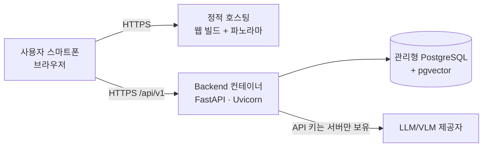
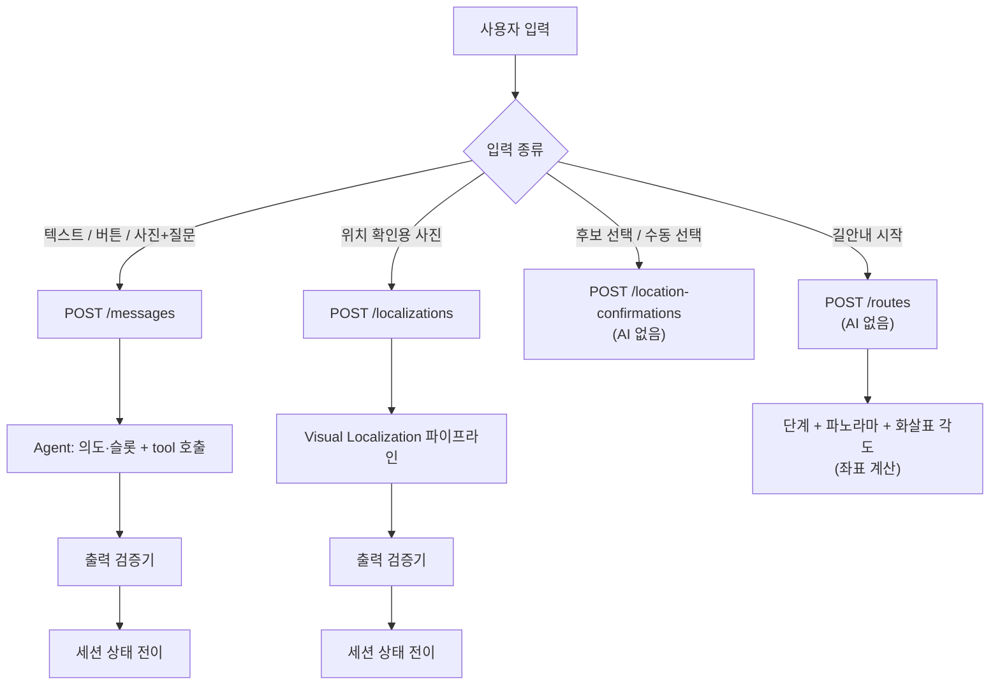
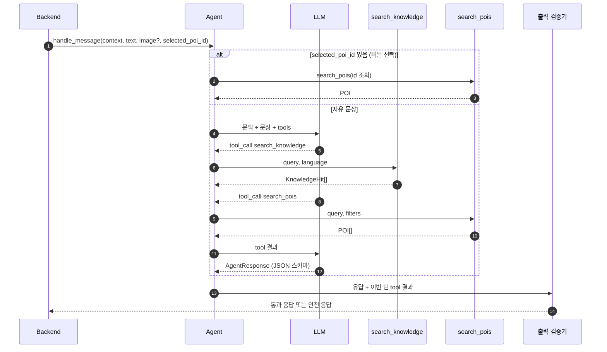
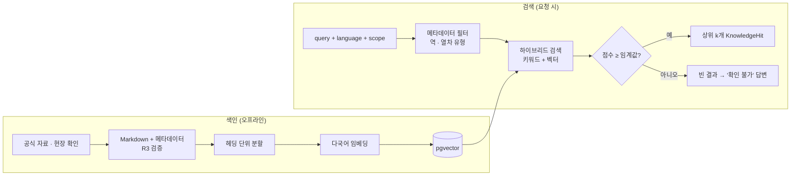
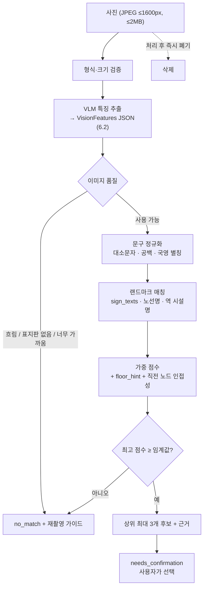
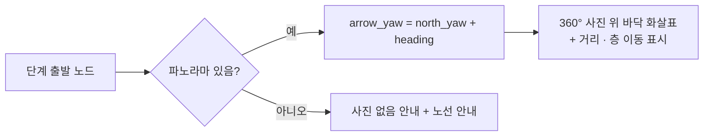
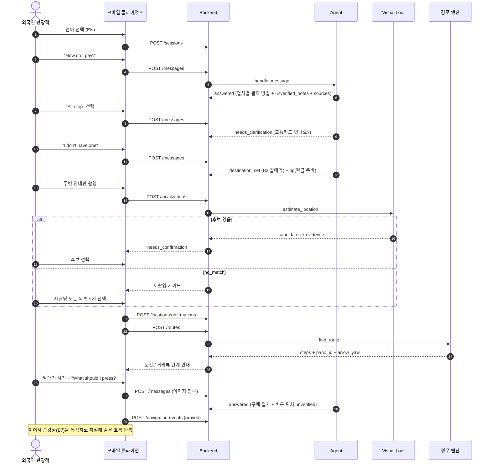

# 한길(Hangil) — 시스템·AI 설계서

| 항목 | 내용 |
|---|---|
| 문서 버전 | v0.2 (초안) |
| 작성일 | 2026-10-22 |
| 작성 | R4 박희태 (팀 검토 전) |
| 근거 문서 | 요구사항 명세서 v0.2, 문제 해결형 API·시퀀스 설계 v0.3, 웹 프로토타입 (`team-onetruck/oneload-app`) |
| 서비스 설계서 단계 | STEP 05 AI 설계 (시스템 구성 · AI 처리 흐름 · 기술 선택 근거 · AI 출력 규격) |

> **이 문서의 결정 한 줄:** MVP는 **모바일 클라이언트에서 "노선(2D 단계 안내) + 거리뷰(360° 현장 사진 위 화살표)"**로 길을 안내한다. **실시간 AR 길안내는 고도화 단계**로 미루고, 지금 데이터와 API는 AR을 나중에 붙일 수 있는 형태로 만든다.

### v0.1 대비 변경

| # | 변경 | 이유 |
|---|---|---|
| 1 | AR 길안내를 "앱의 기능" → **고도화 단계**로 이동 (12장) | 마커 부착 허가, cm 단위 측량, 정합 실험, 별도 Unity 클라이언트까지 미니프로젝트 일정에 담기 어려움 |
| 2 | **거리뷰 안내** 추가 (지점별 360° 사진 + 바닥 화살표) | 실시간 추적 없이 "실제 모습"을 보여줄 수 있고, 웹에서 시연 가능. 요구사항 FR-18(안내 이미지)도 충족 |
| 3 | 대표 시나리오를 **서울역 공항철도 + 결제 방법을 모르는 외국인**으로 구체화 | 교통카드·1회용 승차권·직통열차 승차권, 카드·현금 구분이 외국인의 실제 막힘 지점 |
| 4 | 층 정보를 **AREX 공식 안내** 기준으로 고정 (직통 표 B2, 일반 표 B3, 승강장 B7) | 확인 가능한 사실은 실제 값으로, 나머지는 현장 확인 전 값으로 구분 |
| 5 | `AgentResponse`에 `tip`, `unverified_notes` 추가 | 실용 조언과 "확인되지 않음" 문구를 구조적으로 분리 |

### STEP 05 요구 항목과 이 문서의 대응

| STEP 05 항목 | 이 문서 |
|---|---|
| 시스템 구성 | 2장, 3장 |
| AI 처리 흐름 | 5장 |
| 기술 선택 근거 | 4장 |
| AI 출력 규격 | 6장 |
| (Mini-project 연계) API 명세 재사용 | 8장 (v0.3 요약·차이점만 기술) |

---

## 1. 범위

### 1.1 두 문서 사이의 정리

| 쟁점 | 요구사항 v0.2 | API 설계 v0.3 | **이 설계서의 결정** |
|---|---|---|---|
| 클라이언트 | 모바일 웹 데모 | Unity AR 네이티브 앱 | **모바일 웹(PWA)으로 시연**. 같은 API를 쓰므로 이후 앱으로 감싸도 서버는 그대로 |
| 길안내 표현 | 단계별 안내 | AR 바닥 화살표 | **노선(2D 단계) + 거리뷰(360° 사진 위 화살표)** |
| AR 길안내 | 1차 제외 (FR-20, P2) | MVP 필수 | **고도화 단계** (12장). MVP 합격 조건에 넣지 않음 |
| 위치 확정 수단 | 사진 후보 확인 · 수동 선택 | 마커(기본) · 사진 · 수동 | **사진 후보 · 수동 선택**. 마커는 AR 고도화와 함께 |
| 이탈 재탐색 | 사용자 신고 + 위치 재확인 | 기기 자동 감지 | **사용자 신고 → 재확인**. 자동 감지는 고도화 |

**AR을 미룬 이유:** v0.3 스스로 AR 정합을 "가장 중요한 기술 검증"으로 분류했고, 성립하려면 ① 서울역에 마커 부착 허가, ② 마커 위치·방향을 수십 cm·몇 도 이내로 측량, ③ 별도 Unity 클라이언트와 기기 실증이 모두 필요하다. 거리뷰는 이 셋 없이도 "어디를 보고 어디로 가야 하는지"를 보여준다.

### 1.2 대표 과업 (요구사항 US-03, AT-10)

> 서울역에 도착한 외국인 관광객이 인천공항으로 가려 한다. 공항철도가 처음이고, **표를 사야 하는지, 교통카드를 쓰는지, 카드와 현금 중 무엇이 되는지** 모른다.

1. "How do I pay?" → 열차별 결제 방법 설명: 직통열차는 B2에서 승차권 구매(카드·현금), 일반열차는 교통카드 태그, 카드가 없으면 B3에서 1회용 교통카드 구매
2. 열차 선택. **일반열차면 "교통카드가 있나요?"를 먼저 묻는다.** 있으면 B3 개찰구 → B7 승강장, 없으면 B3 발매기로 안내
3. 주변 안내판 사진 → 위치 후보(KTX 맞이방, 1·4호선 개찰구 등)와 판단 근거 → 사용자 확인
4. 노선 또는 거리뷰로 단계별 이동 → 표 사는 곳 도착
5. 발매기 사진 + "What should I press?" → 구매 절차 설명 (버튼 위치는 "확인되지 않음"으로 표시)
6. 승강장(B7)까지 이어서 안내

보조 시나리오: 잘못 든 길 복구(US-02), 교통카드 충전·보증금 환급(US-04), 요금 질문 거절(AT-06).

### 1.3 설계 원칙

1. **AI는 보이는 것과 문서에 있는 것만 말한다.** 위치·경로·POI는 등록된 데이터에서만 나온다 (NFR-01, NFR-02).
2. **확정은 사람이 한다.** 사진 위치 추정은 항상 후보로만 반환하고, 사용자 확인 없이 안내를 시작하지 않는다.
3. **LLM이 만든 값은 서버가 검증한다.** POI ID, 출처 문서 ID는 tool 결과에 있는 값만 통과시킨다.
4. **결정적인 일은 코드가 한다.** 경로 계산, 단계 안내 문구, 거리뷰 화살표 방향은 LLM이 아니라 그래프·템플릿·좌표 계산이 만든다.
5. **모르는 것은 모른다고 표시한다.** 확인 전 정보(요금, 버튼 위치, 카드 결제 가능 기기)는 답변 안에서 "확인되지 않음"으로 구분한다.

---

## 2. 시스템 구성

### 2.1 구성도

> 원본이 참조한 구성도 이미지 파일은 제공되지 않았습니다. 구성요소는 아래 2.2 표와 2.3 배포 구성도로 확인합니다.

- **MVP 기준으로 읽는 법:** 그림의 "AR 앱"은 **모바일 클라이언트(웹 PWA)**, "단말 내부 처리"는 **노선·거리뷰 렌더(360° 사진 위 화살표)**로 읽는다. AR 추적·마커 정합은 고도화(12장)다. 그림 자체도 다음 수정 때 이렇게 바꾼다.
- **그림에 생략된 요소** (2.2 표와 4장에서 다룸):
  - **외부 LLM/VLM API**: AI Agent와 사진 위치 인식이 호출한다. API 키는 Backend만 보유한다.
  - **출력 검증기**: AI Agent·사진 위치 인식의 결과가 Backend로 돌아올 때 POI ID·출처·스키마를 검사한다 (5.5).
  - **지식 저장소**(pgvector): RAG가 검색하는 검증된 교통 이용 문서.
  - **파노라마 저장소**: 지점별 360° 사진 (정적 파일, `map_version`과 함께 버전 관리).

### 2.2 구성요소 책임

| 구성요소 | 담당 | 책임 | 하지 않는 일 |
|---|---|---|---|
| 모바일 클라이언트 | R5 | 언어 선택, 대화, 사진 촬영/업로드, 후보 확인, **노선 안내, 거리뷰(360° 사진 + 화살표)**, 오류·재시도 화면 | 위치 판단, 경로 계산 |
| REST API | R4 | 토큰·입력 검증, 이미지 제한, 오류 포맷, 요청 로그 | AI 판단 |
| 세션 상태 머신 | R4 | v0.3 4장 상태 전이표 집행, `revision`·`Idempotency-Key` | — |
| AI Agent | R2 | 의도·슬롯 추출, 추가 질문, tool 호출, 응답 문장 | **경로 계산, POI ID 생성** |
| Visual Localization | R2 | 사진에서 특징 추출 → 랜드마크 매칭 → 노드 후보 | **위치 확정** |
| RAG | R3 | 지식 문서 수집·분할·색인·검색, 출처·확인일 관리 | 답변 생성 |
| 경로 엔진 | R4 | 그래프 최단 경로, 이동 선호 반영, 단계 안내 생성, **단계별 파노라마·화살표 각도 계산** | 등록되지 않은 통로 생성 |
| 출력 검증기 | R4 (R2 협업) | LLM 출력의 스키마·ID·출처 검증, 실패 시 안전 응답으로 대체 | — |
| 공간 데이터 | R4 주관, 팀 공동 답사 | 노드·엣지·POI, 표지판 문구, **360° 촬영과 방향 보정값** | — |
| 평가 로깅 | R6 (R4 구현) | 시나리오 결과, 단계별 지연, 실패 사유 | 원본 이미지 영구 저장 |

### 2.3 배포 구성



- **HTTPS 필수:** 브라우저 카메라와 폰 자이로(거리뷰 둘러보기)는 보안 컨텍스트에서만 동작한다.
- **현재 시연 환경:** 웹 프로토타입은 팀 서버(macserver)의 Caddy가 정적 파일을 압축·캐시해 제공하고, Tailscale Funnel로 외부 HTTPS 주소를 연다. 본 배포는 CDN 정적 호스팅이 더 빠르다 (9장 성능).
- 공간 데이터·파노라마·지식 원문은 **레포와 정적 저장소에 버전 관리**하고, 서버 기동 시 적재한다. `map_version`은 공간 데이터 묶음의 버전이다.
- 단일 Backend 프로세스 안에서 Agent·VL·RAG·경로 엔진을 **타입 지정 함수 호출**로 연결한다 (v0.3 3장).

---

## 3. 데이터 설계

### 3.1 공간 데이터 (요구사항 6.1, v0.3 8.3)

| 엔터티 | 핵심 필드 | MVP | 고도화(AR) 추가 |
|---|---|---|---|
| Floor | `floor_id`, `elevation_m` | O | — |
| Node | `id`, `floor_id`, `position`, 구역 | O | — |
| Edge | `from`, `to`, `type`(corridor/stairs/escalator/elevator/gate), `distance_m`, **`heading_deg`**, `bidirectional`, 제한 조건 | O | — |
| POI | `poi_id`, `name_ko/en`, `category`, `nearest_node_id`, `aliases`, **`verified`** | O | — |
| Landmark | `id`, `node_id`, 표지판 문구(`sign_texts`), 특징, 촬영 방향, **`verified`** | O (사진 매칭용) | 마커 `pose_map`, `marker_size_m`, `surveyed_at` |
| **Panorama** | `pano_id`, `node_id`, `image_url`, **`north_yaw_deg`**, `captured_at`, **`faces_blurred`** | O (거리뷰) | — |

- **좌표·방향 규약은 v0.3 2.1을 지금부터 따른다** (`+z`=북, 방향각은 북=0°·시계방향). AR 고도화 때 데이터를 다시 만들지 않기 위해서다.
- **거리뷰 화살표는 저장하지 않는다.** 화살표 각도 = `Panorama.north_yaw_deg + Edge.heading_deg`. 경로가 바뀌어도 사진·데이터는 그대로다.
- `verified: false`인 POI·랜드마크, `faces_blurred: false`인 파노라마는 사용자에게 내보내지 않는다.
- **현장 답사 때 수집할 것:** 지점별 360° 사진과 그 사진의 북쪽 방향, 표지판 문구(국/영), 통로 연결과 대략 거리. 파노라마는 사진 위치 인식의 **기준 이미지**로도 재사용한다 (5.4).
- **현재 확정된 사실:** 직통열차 표 사는 곳 B2, 일반열차 표 사는 곳 B3, 승강장 B7 ([AREX 공식 안내](https://www.airportrailroad.com/co/steUsfGud.do), 2026-10-22 확인). 통로·거리·표지판 문구는 답사 전 값이다.

### 3.2 지식 데이터 (요구사항 6.2)

문서 1건 = Markdown 파일 1개 + 머리말 메타데이터.

```yaml
doc_id: doc-arex-express-ticket
title: 공항철도 직통열차 승차권 구매 방법
language: ko            # ko | en
question_types: [ticket_purchase, payment, train_type]
scope: { station: seoul, train_type: express }
source_url: https://...  # 공식 출처, 없으면 field_check
source_kind: official    # official | field_check
verified_at: 2026-10-20
verified_by: R3
```

- 분할: 제목(헤딩) 단위, 청크마다 메타데이터 상속.
- **MVP 필수 문서 묶음:** 열차 종류(직통/일반), 결제 방법(카드·현금), 교통카드(구매·충전·태그), 1회용 교통카드와 보증금 환급, 직통열차 승차권 구매 절차, 층별 위치.
- 요금·운영시간·결제 가능 수단처럼 바뀌는 값은 `verified_at`이 기준일보다 오래되면 답변에 "확인일" 문구를 붙인다 (FR-12, NFR-08).

### 3.3 세션·운영 데이터

| 테이블 | 내용 | 보존 |
|---|---|---|
| sessions | `session_id`, 토큰 해시, `language`, `state`, `revision`, 목적지, 확정 위치, 슬롯(열차 유형·교통카드 보유), 선호 | 유휴 2시간 만료 |
| messages | 최근 대화 (Agent 문맥용 최근 N턴) | 세션과 함께 |
| localizations | `localization_id`, 후보, 만료 300초 | 세션과 함께 |
| routes | `route_id`, `route_revision`, 경로 결과 | 세션과 함께 |
| idempotency_keys | 키, 요청 해시, 응답 | 24시간 |
| eval_logs | `request_id`, 단계별 지연, 결과 상태, 오류 코드, 모델명·프롬프트 버전 | 평가 기간 |
| feedback | 평가·오류 신고 | 평가 기간 |

- **사용자 사진은 저장하지 않는다.** 처리 후 즉시 폐기, 사용자 동의 시에만 QA용 7일 보관 (v0.3 3장 제안값, NFR-06).
- 로그에는 원문 이미지·얼굴·토큰을 남기지 않는다.

---

## 4. 기술 스택과 선택 근거

> 서버·AI 항목은 **제안안**이다. 클라이언트 항목은 웹 프로토타입으로 검증했다.

| 영역 | 선택 | 선택 근거 | 검토한 대안 |
|---|---|---|---|
| 클라이언트 | **React + TypeScript + Vite** 모바일 웹, **PWA** (프로토타입으로 검증) | 설치 없이 QR 링크로 시연. 사진 업로드는 `<input capture>`로 충분. 같은 API를 쓰므로 이후 앱으로 감싸도 서버는 그대로 | 네이티브 앱: 배포·심사 부담 |
| 거리뷰 뷰어 | **Photo Sphere Viewer** (three.js 기반) + 마커·자이로 플러그인 | 360° 사진 위 화살표 마커, 폰 기울여 둘러보기를 바로 지원. **첫 로딩에서 분리(지연 로딩)** 해 초기 번들을 줄임 | 직접 three.js 구현: 시간 대비 이득 작음. 네이버 파노라마 API: 서울역 실내 커버리지·이용 조건 미확인 |
| 파노라마 형식 | **WebP, 긴 변 2560px** | 장당 약 270KB (JPEG 약 2MB 대비). 지하 데이터 환경 고려 | 원본 4K: 화질 이득 대비 로딩 비용 큼 |
| Backend | **Python 3.12 + FastAPI + Pydantic v2** | AI·RAG 생태계가 Python. Pydantic 모델 하나로 **API 검증 · OpenAPI 문서 · LLM 구조화 출력 스키마**를 함께 만든다 | Node/NestJS: AI 모듈과 언어 분리 |
| LLM / VLM | **멀티모달 상용 모델 1종** (tool calling + JSON 스키마 강제 출력 지원 필수). 모델명은 지연·비용 측정 후 확정 | 이미지 이해와 대화를 한 모델로 처리해 연동 단순화. 스키마 강제 출력으로 파싱 실패 감소 | 오픈소스 VLM 자체 호스팅: GPU·운영 부담 |
| 모델 연동 | **얇은 어댑터 계층** (`LLMClient` 인터페이스) | 제공자 교체·평가 비교가 쉬움 | — |
| Agent 구현 | **직접 구현한 tool-calling 루프** (최대 3회 tool 호출) | tool이 2개뿐이고 상태는 Backend가 관리한다. 흐름이 투명해 디버깅·평가가 쉽다 | LangChain/LangGraph: 추상화 대비 이득이 작음 |
| OCR | **VLM이 표지판 문구 추출** (1차). 전용 OCR은 비교 실험용 | 한·영 혼합 표지판을 맥락과 함께 읽음. 컴포넌트 수 최소화 | PaddleOCR, 클라우드 OCR: 오인식 사례 비교용으로만 |
| 위치 매칭 | **규칙 기반 매처** (문구 정규화 + 가중 점수) | VLM이 노드 ID를 고르지 않게 해 환각 차단. 결과를 근거와 함께 설명 가능 | 파노라마 이미지 임베딩 검색: 촬영본 확보 후 2차 실험 |
| 임베딩 | **다국어 임베딩 모델** | 영어 질문으로 한국어 문서도 검색해야 함 | 언어별 단일 모델 |
| 벡터 저장소 | **PostgreSQL + pgvector** | 세션·로그와 저장소 하나로 통일. 메타데이터(언어·역·열차유형·확인일) 필터를 SQL로 처리 | Chroma: 별도 저장소 추가 |
| 검색 방식 | **하이브리드** (키워드 + 벡터) | "직통", "AREX", "T-money" 같은 고유명사는 키워드가 강함 | 벡터 단독 |
| 경로 엔진 | **NetworkX 다익스트라** | 노드 수십~수백 개 규모라 충분. 엣지 제외(계단 회피)가 쉬움 | 자체 A*: 이득 없음 |
| 단계 안내 문구 | **국/영 템플릿** | 경로 안내에 LLM 환각이 섞이지 않음 (NFR-01) | LLM 생성: 거리·방향 왜곡 위험 |
| 배포 | **Docker 컨테이너 1개 + 관리형 PostgreSQL**, 정적 호스팅 (시연은 Caddy + Tailscale Funnel) | 미니프로젝트 일정에 맞는 최소 운영 | 쿠버네티스: 과함 |
| 관측성 | 구조화 JSON 로그 + `request_id` + 단계별 소요 시간 | NFR-09, 평가 지표(지연 중앙값·상위 백분위) 산출 | APM 도입: 규모 대비 과함 |

---

## 5. AI 처리 흐름

### 5.1 요청 종류별 처리 경로



AI가 관여하는 API는 **`/messages`와 `/localizations` 두 개뿐**이다. 위치 확정, 경로 계산, 거리뷰 화살표는 결정적 코드다.

### 5.2 Agent (대화) 흐름

**의도 분류**

| intent | 예시 | 처리 |
|---|---|---|
| `navigate_to_poi` | "승강장 어디예요?" | POI 검색 → 목적지 확정 또는 재질문 |
| `ticket_purchase_and_navigation` | "공항 가는 표 어디서 사?" | 지식 검색 + 열차 유형 슬롯 확인 → POI 확정 |
| `payment_question` | "How do I pay?", "신용카드 돼요?", "교통카드가 뭐예요?", "충전은?" | 지식 검색 → 열차별 결제 방법, 확인 안 된 부분은 `unverified_notes` |
| `usage_question` | "What should I press?", "보증금 어떻게 돌려받아?" | 지식 검색 → 근거 기반 답변 |
| `report_off_route` | "길을 잘못 든 것 같아" | 위치 재확인 요청 (`needs_location`) |
| `out_of_scope` | 범위 밖 질문 | 정중히 범위 안내 |

**슬롯:** `train_type`(`express` / `allstop` / `unknown`), **`has_transit_card`**(`yes` / `no` / `unknown`), `language`.

- 일반열차를 고르면 `has_transit_card`를 먼저 채운다. **있으면 목적지 = 일반열차 승강장(B3 개찰구 경유), 없으면 목적지 = B3 발매기.** 같은 "일반열차"라도 목적지가 달라지는 지점이다.

**처리 단계**

1. Backend가 `SessionContext`(언어, 상태, 목적지, 확정 위치, 슬롯, 최근 대화)를 만든다.
2. LLM 호출: 시스템 프롬프트 + 문맥 + 사용자 문장(+ 첨부 사진) + tool 정의(`search_knowledge`, `search_pois`).
3. LLM이 tool을 요청하면 실행 후 결과를 돌려준다. **최대 3회**, 초과 시 현재까지 결과로 응답을 강제한다.
4. 최종 출력은 **`AgentResponse` JSON 스키마로 강제**한다 (6.1).
5. 출력 검증기(5.5)를 통과하면 상태를 전이하고 응답한다.

**프롬프트 핵심 규칙** (시스템 프롬프트에 명시)

- 요금·위치·층·버튼 위치·운영시간·**결제 가능 수단**은 **tool 결과에 있을 때만** 말한다. 문서가 "확인 전"으로 표시한 내용은 `unverified_notes`로 분리한다 (AT-06).
- 목적지가 두 개 이상 해석되면 단정하지 않고 `suggested_replies`로 묻는다 (예: 일반/직통, 교통카드 유무).
- 결제·예매를 대신 해준다고 말하지 않는다 (AT-11).
- 응답 언어는 `session.language`를 따른다 (AT-08).



### 5.3 RAG 흐름



- 질문 언어와 문서 언어가 달라도 검색한다. 답변은 세션 언어로 번역·요약하되, **고유명사·요금 숫자는 원문 값을 유지**한다.
- 임계값과 k는 R3·R6가 평가셋으로 정한다. 초기값 k=4.
- 검색 결과가 비면 Agent는 답을 지어내지 않는다. 이것이 AT-06의 핵심 경로다.

### 5.4 Visual Localization 흐름

**핵심 아이디어: VLM은 "무엇이 보이는지"만 구조화해서 말하고, "어디인지"는 매처가 등록 데이터로 정한다.**



- **절대 자동 확정하지 않는다.** 후보가 1개여도 사용자 확인을 받는다 (NFR-02, AT-01).
- `rank_score`는 후보 정렬용 상대 점수다. 화면에 확률·%로 보여주지 않는다. 프로토타입은 순위를 **링 크기와 순서**로만 표현한다.
- `evidence`는 사용자에게 보여줄 판단 근거다. 예: "'공항철도 Airport Railroad' 환승 화살표", "4호선 색 표시".
- 단서가 없으면 `no_match`와 함께 **구체적 재촬영 요청**과 **목록에서 고르기**를 준다 (FR-06, AT-02).
- **2차 실험:** 촬영한 파노라마를 잘라 기준 이미지로 쓰고, 사용자 사진과 이미지 유사도를 매칭 점수에 더한다. 표지판 문구가 안 보이는 사진의 보완책이다.

### 5.5 출력 검증기 (환각 차단 장치)

| 검사 | 실패 시 처리 |
|---|---|
| JSON 스키마 위반 | 1회 재요청, 다시 실패하면 안전 응답 ("잠시 후 다시 시도" + 수동 선택 버튼) |
| `destination.poi_id`가 이번 턴 `search_pois` 결과에 없음, 또는 `verified: false` | 목적지 폐기 → `needs_clarification` (v0.3 8.5) |
| `sources[].document_id`가 이번 턴 `search_knowledge` 결과에 없음 | 해당 출처 제거. 출처가 0개가 되면 사실형 답변에 불확실성 문구 부착 |
| 답변의 사실 문장이 `verified_at` 없는 문서에서 왔음 | 해당 문장을 `unverified_notes`로 이동 |
| `candidates[].node_id`가 지도에 없거나 매처 결과에 없음 | 해당 후보 제거, 0개면 `no_match` |
| `intent`·`status`·`next_action`이 허용 값이 아님 | 안전 응답 |
| 현재 세션 `state`에서 허용되지 않는 전이 | `409 INVALID_STATE` 대신 상태 유지 + 안내 문구 |

검증 실패는 모두 `eval_logs`에 사유 코드와 함께 기록해 R6의 오류 분석에 쓴다.

### 5.6 경로 계산, 단계 안내, 거리뷰 (AI 없음)

1. 출발 노드(확정 위치) · 목적 POI의 `nearest_node_id`로 다익스트라.
2. 비용 = `distance_m` × 엣지 유형 가중치. `avoid_stairs`이면 계단 엣지 제외 (FR-17, 데이터 확보 시).
3. 경로가 없으면 `422 ROUTE_NOT_FOUND`와 함께 선호 조건 완화 제안.
4. 연속된 같은 유형의 엣지를 묶어 단계(`walk`, `escalator_down`, `gate`, …)를 만들고, **국/영 템플릿**에 거리·층·기준 시설물을 채운다 (FR-08).
5. **거리뷰:** 각 단계의 출발 노드에 파노라마가 있으면 `pano_id`와 `arrow_yaw_deg = north_yaw_deg + heading_deg`를 붙인다. 없으면 `pano_id: null`이고 화면은 "아직 사진이 없어요"와 노선 안내로 대체한다.



### 5.7 시간 예산

| 단계 | 예산 (초기안) |
|---|---|
| `/messages` 전체 | 서버 15초 / 앱 타임아웃 20초 |
| `/localizations` 전체 | 서버 15초 / 앱 타임아웃 20초 |
| 15초 초과 | `503 AI_SERVICE_UNAVAILABLE`, `retryable: true` → 수동 목적지·위치 선택 제시 |

단계별(LLM 호출, 검색, 매칭) 소요 시간을 로그로 남기고, 목표치는 기준선 측정 후 확정한다 (NFR-03).

---

## 6. AI 출력 규격

모든 규격은 Pydantic 모델로 정의하고, 같은 모델에서 **LLM 구조화 출력 스키마**와 **API 응답 스키마**를 생성한다.

### 6.1 `AgentResponse` (Agent → Backend)

```json
{
  "status": "answered",
  "intent": "payment_question",
  "assistant_message": "It depends on the train:",
  "list": [
    "Express: buy a ticket at the counter or machine on B2. Card or cash.",
    "All-stop with a transit card: just tap it at the gate on B3.",
    "All-stop without a card: buy a single-journey ticket at the machine on B3."
  ],
  "tip": null,
  "unverified_notes": ["Which machines here accept credit cards is not confirmed yet. Keep some cash (won) just in case."],
  "slots": { "train_type": "unknown", "has_transit_card": "unknown" },
  "destination": null,
  "suggested_replies": [
    { "label": "Express", "selected_poi_id": null },
    { "label": "All-stop", "selected_poi_id": null },
    { "label": "What’s a transit card?", "selected_poi_id": null }
  ],
  "sources": [{ "document_id": "arex-official-seoul-floors", "title": "AREX official guide: Seoul Station", "source_url": "https://www.airportrailroad.com/co/steUsfGud.do", "verified_at": "2026-10-22" }],
  "next_action": "reply"
}
```

| 필드 | 타입 | 규칙 |
|---|---|---|
| `status` | enum | `answered` · `needs_clarification` · `destination_set` · `relocalize` · `cannot_answer` · `out_of_scope` |
| `intent` | enum | 5.2 의도 표 |
| `assistant_message` | string | 세션 언어. 사용자에게 그대로 보여주는 문장 |
| `list` | string[] | 절차·선택지. 화면에서 번호 목록으로 표시 |
| `tip` | string 또는 null | 목적지에 맞는 실용 조언 (예: "현금만 될 수 있으니 원화를 준비하세요") |
| `unverified_notes` | string[] | **확인 전 정보.** 화면에서 "확인되지 않음" 표시와 함께 분리해 보여준다 |
| `slots` | object | `train_type`, `has_transit_card` |
| `destination` | `{poi_id}` 또는 null | **검증기 통과 필수** |
| `suggested_replies` | array | 최대 4개. `selected_poi_id`도 검증 대상 |
| `sources` | `KnowledgeHit` 참조 배열 | `document_id`, `title`, `source_url`, `verified_at` |
| `next_action` | enum | `reply` · `locate` · `confirm_location` · `navigate` · `recapture` · `none` |

> v0.3 대비 추가 제안: `status`의 `answered`·`relocalize`·`cannot_answer`·`out_of_scope`, `list`, `tip`, `unverified_notes`, `slots`, `next_action`의 `navigate`·`none`. 팀 합의 후 v0.3에 반영한다.

**상태 전이 매핑**

| `status` | 세션 `state` 변화 |
|---|---|
| `needs_clarification` | → `needs_clarification` |
| `destination_set` | 확정 위치 없음 → `needs_location`, 있음 → `ready_to_navigate` |
| `relocalize` | `navigating` → `needs_location` |
| `answered`, `cannot_answer`, `out_of_scope` | 변화 없음 |

### 6.2 `VisionFeatures` (VLM → 매처, 내부 전용)

```json
{
  "image_quality": "usable",
  "scene_type": "transfer_passage",
  "texts": [
    { "text": "공항철도", "lang": "ko", "kind": "line_name" },
    { "text": "Airport Railroad", "lang": "en", "kind": "line_name" },
    { "text": "4", "lang": null, "kind": "line_number" }
  ],
  "facilities": ["ticket_gate", "escalator"],
  "person_visible": false
}
```

| 필드 | 규칙 |
|---|---|
| `image_quality` | `usable` · `blurry` · `too_dark` · `no_signage` · `too_close` |
| `texts[].kind` | `line_name` · `line_number` · `exit_number` · `facility_name` · `direction` · `other` |
| `facilities` | 허용 목록(enum)에서만 선택 |
| **금지** | 노드 ID, 위치 이름 추측, 확률 값. 보이지 않는 글자를 추측해 쓰지 않는다 |

### 6.3 `LocationEstimate` (Visual Localization → Backend)

v0.3 10장 규격을 그대로 쓴다.

```json
{
  "status": "needs_confirmation",
  "candidates": [
    { "node_id": "l4gate", "floor_id": "B1", "rank_score": 0.85, "heading_deg": null,
      "landmark_id": "lm-l4-transfer", "evidence": ["“공항철도 Airport Railroad” 환승 화살표", "같은 안내판의 4호선 색 표시"] }
  ],
  "retake_hint": null
}
```

- `status`: `needs_confirmation` · `no_match`.
- `candidates`: 최대 3개, `rank_score` 내림차순.
- `retake_hint`(추가 제안): `no_match`일 때 사용자 언어의 재촬영 가이드. `image_quality`에서 결정적으로 생성한다.
- `heading_deg`: 랜드마크 촬영 방향이 등록된 경우만 채운다. 없으면 null.

### 6.4 `KnowledgeHit` (RAG → Agent)

```json
{ "document_id": "doc-arex-express-ticket", "title": "공항철도 직통열차 승차권 구매 방법",
  "excerpt": "...", "language": "ko", "source_url": "https://...", "source_kind": "official",
  "verified_at": "2026-10-20", "scope": { "station": "seoul", "train_type": "express" }, "score": 0.71 }
```

### 6.5 실패·불확실 응답 원칙

| 상황 | 사용자에게 보이는 결과 |
|---|---|
| 근거 문서 없음 (예: 요금) | "확인된 정보가 없어서 추측하지 않을게요" + 확인 방법 안내 |
| 일부만 확인됨 (예: 카드 결제 가능 기기) | 확인된 부분은 본문, 나머지는 **"확인되지 않음" 표시** |
| 위치 단서 없음 | `no_match` + 구체적 재촬영 가이드 + **목록에서 고르기** |
| 후보 여럿 | 후보 목록 + 근거, 사용자 선택 |
| 거리뷰 사진 없는 지점 | "아직 사진이 없어요" + 노선 안내로 대체 |
| LLM 장애·시간 초과 | 오류 문구 + 재시도 + 수동 목적지·위치 선택 (AT-07) |

---

## 7. 대표 시나리오 시퀀스



- **`/messages` 이미지 첨부:** 발매기 질문(US-03)을 위해 `/messages`에 선택적 이미지(multipart)를 허용한다. Agent는 VLM으로 화면 문구를 읽되, **버튼 위치·요금은 지식 문서에 있을 때만** 답한다. v0.3 개정 사항이다.
- **길을 잘못 든 경우 (US-02):** "길을 잃었어요" 버튼 또는 문장 → Agent `relocalize` → `needs_location` → 사진/목록으로 재확인 → `/routes` (`reroute: true`).

---

## 8. API 명세 재사용 (v0.3 기준)

v0.3의 엔드포인트·오류 포맷·상태 전이표·멱등성·revision 규칙을 **그대로 사용**한다. 아래는 MVP와 AR 고도화의 적용 범위, 그리고 거리뷰를 위한 추가만 정리한다.

| # | API | MVP | AR 고도화 | 비고 |
|---|---|:---:|:---:|---|
| 1 | `POST /sessions` | O | O | `client.ar_capable`은 고도화 때 사용 |
| 2–4 | `GET /maps`, `/graph`, `/pois` | O | O | **`/graph` 응답에 `panoramas[]` 추가**, 엣지에 `heading_deg` 추가. 마커 포즈·`client_thresholds`는 고도화 |
| 5 | `POST /messages` | O | O | **선택적 이미지 첨부 추가** (7장) |
| 6 | `POST /localizations` | O | O | `ar_session_id`·`ar_pose_at_capture`는 고도화 |
| 7 | `POST /location-confirmations` | O | O | MVP: `photo_candidate`, `manual`. `marker`는 고도화 |
| 8 | `POST /routes` | O | O | **`steps[]`에 `pano_id`, `arrow_yaw_deg` 추가.** `start.type = map_position`은 고도화 |
| 9 | `POST /ar-alignments` | — | O | 고도화 전용 |
| 10 | `POST /navigation-events` | O | O | MVP: `navigation_started`, `arrived`, `navigation_cancelled`. 추적 관련 이벤트는 고도화 |
| 11–14 | `navigation-state`, `PATCH`, `feedback`, `health` | O | O | — |

**`/routes` 응답 단계 예시 (추가 필드만)**

```json
{ "step_id": "s1", "kind": "escalator_down", "from_node_id": "l4gate", "to_node_id": "concourse",
  "instruction_en": "Follow the “Airport Railroad” transfer signs, then go down to B2.",
  "distance_m": 110, "pano_id": "pano-l4gate", "arrow_yaw_deg": -80 }
```

- 세션 상태 머신은 하나다. MVP에서는 `relocalization_required`로 가는 자동 전이(`tracking_lost`)가 발생하지 않을 뿐이다.
- 단계 진행은 사용자의 "다음" 탭으로 하고, 도착은 사용자가 확인한다.

---

## 9. 비기능 설계

| NFR | 설계 대응 |
|---|---|
| NFR-01 정확성 | 경로는 등록 엣지만 사용, 단계 문구는 템플릿, 화살표는 좌표 계산 |
| NFR-02 신뢰성 | 위치 자동 확정 금지, 출력 검증기, 확인 전 정보 분리 표시 |
| NFR-03 응답성 | AI 요청 15초 서버 예산. **첫 화면 로딩:** 거리뷰 라이브러리 지연 로딩, 정적 파일 압축·장기 캐시 |
| NFR-04 사용성 | 한 손 조작 기준 큰 버튼, 노선/거리뷰 전환, 하단 고정 "다음 / 길을 잃었어요" |
| NFR-05 다국어 | 템플릿·오류 문구 국/영 쌍으로 관리, Agent 응답 언어 고정, 한국어 단어 단위 줄바꿈 |
| NFR-06 개인정보 | 사용자 사진 즉시 폐기, 동의 시 7일. **파노라마는 얼굴 블러 후에만 공개** |
| NFR-07 보안 | LLM API 키는 서버 환경변수, 세션 토큰은 해시 저장, 이미지 크기·형식 제한, IP rate limit |
| NFR-08 출처 관리 | 지식 문서 `source_url`·`verified_at`, 공간 데이터 `map_version`, 파노라마 `captured_at` |
| NFR-09 관측성 | `request_id`, 단계별 지연, 검증 실패 사유 코드, 모델명·프롬프트 버전 기록 |
| NFR-10 접근성 | 안내는 항상 텍스트 동반, 색상 단독 구분 금지 |

**프로토타입에서 측정한 첫 로딩 (시연 서버, 외부망 기준)**

| 항목 | 개선 전 | 개선 후 |
|---|---|---|
| 첫 화면 JS | 957KB · 12.8초 | 92KB(압축) · 1.5초 |
| CSS | 81KB · 3.8초 | 22KB(압축) · 1.5초 |
| 파노라마 1장 | 약 2MB | 약 270KB |

첫 요청에 약 0.9초는 Tailscale Funnel 중계 구간이라 서버에서 줄일 수 없다. 본 배포는 CDN 정적 호스팅을 쓴다.

**프롬프트·모델 버전 관리:** 프롬프트 파일을 레포에서 버전 관리하고, 로그에 버전을 남겨 R6가 개선 전후를 비교할 수 있게 한다.

---

## 10. 요구사항 추적

| FR | 담당 구성요소 |
|---|---|
| FR-01 언어 · FR-13 문맥 | 세션 상태 머신, Agent |
| FR-02 목적지 | `/pois`, Agent `search_pois` |
| FR-03~06 이미지·위치·불확실성 | Visual Localization, 출력 검증기 |
| FR-07~09 경로·단계·재탐색 | 경로 엔진, Agent `relocalize` |
| FR-10~12 질의응답·근거·출처 | Agent, RAG, 출력 검증기 (`unverified_notes`) |
| FR-14 오류 | 공통 오류 포맷 (v0.3 9장) |
| FR-15 데이터 관리 | 레포 내 공간·지식 파일 + 파노라마 + 적재 스크립트 |
| FR-16 평가 로깅 | `eval_logs` |
| FR-18 안내 이미지 (P1) | **거리뷰로 MVP에 포함** |
| FR-20 AR (P2) | **고도화 단계** (12장) |

---

## 11. 리스크와 미확정 사항

| 항목 | 영향 | 대응 / 결정 필요자 |
|---|---|---|
| 역사 내 360° 촬영 허가 | 거리뷰 성립 여부 | 코레일·공항철도 문의 (R1) |
| 파노라마 얼굴 블러 | 개인정보 (NFR-06) | 촬영 후 블러 처리 절차 확정 (R3·R6) |
| 표지판 문구(`sign_texts`) 확보 | 위치 추정 정확도의 핵심 | 답사 때 문구·사진 수집 (전원) |
| 카드 결제 가능 기기·요금 | 결제 안내의 핵심 정보 | 공식 자료·현장 확인 전까지 `unverified`로 표시 (R3) |
| 파노라마 노후화 | 공사·표지 교체 시 잘못된 화면 | `captured_at` 표시, 답사 주기 정의 (R6) |
| `/messages` 이미지 첨부 | US-03 발매기 질문 불가 | v0.3 개정 합의 (R2·R4) |
| LLM/VLM 모델 선정 | 지연·비용·정확도 | 후보 2개 측정 후 확정 (R2·R6) |
| 매칭 임계값·RAG 임계값 | 오확정 vs 과다 재촬영 | 평가셋으로 결정 (R6) |
| 본 배포 플랫폼 | 로딩 속도·일정 | CDN 정적 호스팅 + 컨테이너, 팀 합의 (R1·R4) |

---

## 12. 고도화 단계: 실시간 AR 길안내

MVP에서 뺀 기능이다. **지금 데이터·API를 AR 기준 규약으로 만들어 두었기 때문에, 고도화 때는 클라이언트와 측량 데이터만 추가하면 된다.**

| 항목 | 내용 |
|---|---|
| 기능 | 카메라 위 바닥 화살표(world-locked), 이탈 자동 감지·재탐색, 층 이동 후 재정합 |
| 클라이언트 | Unity + AR Foundation (ARCore/ARKit). iOS 웹 AR은 보장되지 않아 네이티브 필요 |
| 위치 맞춤 | 측량한 마커(QR/AprilTag)로 4DoF 정합(`yaw` + 이동량). 계산·렌더는 기기 안에서만 (v0.3 2장) |
| 추가 데이터 | 층마다 최소 1개 마커의 위치·방향 측량값(수십 cm, 몇 도 이내), `client_thresholds` |
| 추가 API | `/ar-alignments`, `/routes`의 `start.type = map_position`, 추적 관련 `navigation-events` (8장 표) |
| 선행 조건 | 마커 부착 허가, 측량 장비, 단말 확정, "마커 1개로 화살표 하나 고정" 현장 실험 통과 |
| 지금 해둔 준비 | v0.3 좌표·방향 규약 준수, 엣지 `heading_deg`, 세션 상태 머신과 이벤트 규격 공유 |

**중간 단계 선택지:** 거리뷰 화면에서 폰 자이로로 둘러보기는 이미 지원한다. AR 전에 "3D 개략 미리보기(층을 쌓은 경로 그림)"를 넣는 안도 있으나, 실측 좌표가 없으면 정밀해 보이는 그림이 오해를 부를 수 있어 **실측 이후로 미룬다.**

---

## 13. 프로토타입

- 레포: `team-onetruck/oneload-app` (`main`), 시연 주소: `https://baki-macbookpro.tail3286a4.ts.net:10000/`
- 응답·사진 인식·경로는 이 문서의 계약 모양을 따른 **메모리 내 모의 구현**이다. 서버 연동 시 화면 구조를 바꾸지 않고 교체한다.
- 거리뷰 사진은 **다른 역의 CC0 샘플**(Poly Haven)이며 화면에 "예시 사진, 서울역 아님"으로 표시한다.

> **주의:** 이 문서의 ID, 좌표, 점수, 거리, 화살표 각도, 문서 예시는 층 정보(AREX 공식 안내)를 제외하면 모두 가상 값이다. 서울역 실제 데이터는 답사·공식 자료 확인 후 등록한다.
